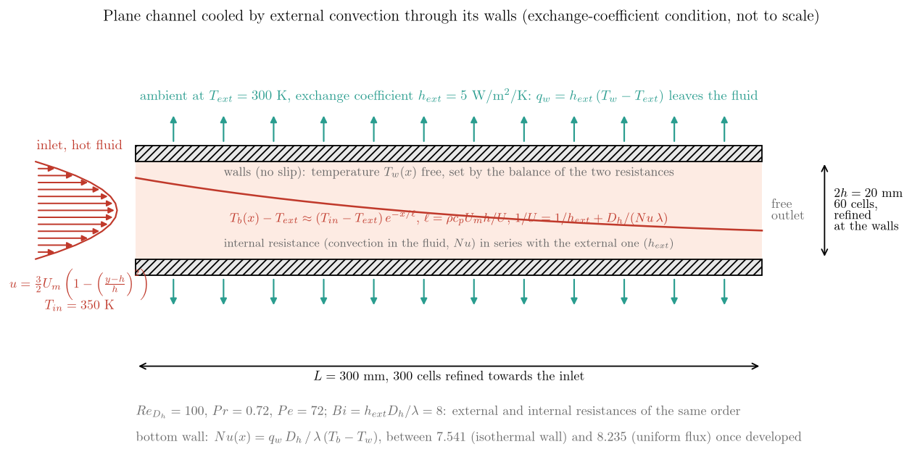
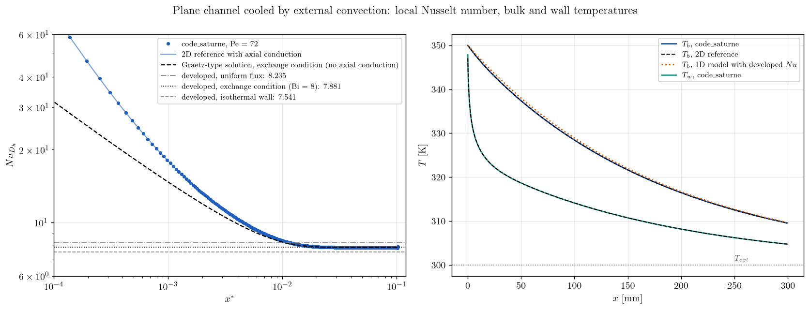

# Channel Cooled by External Convection (Exchange Coefficient Wall)

The third tutorial of the forced-convection series closes the set of thermal wall conditions: after the imposed temperature ([Graetz entrance](../Th_Graetz_Entrance)) and the imposed flux ([uniform flux channel](../Th_Uniform_Flux_Channel)), the wall now exchanges with an **ambient at a given temperature through an exchange coefficient**, $q_w = h_{ext}\,(T_w - T_{ext})$. This is the **Robin condition** (also called boundary condition of the third kind, or mixed condition), which relates the flux to the unknown wall temperature instead of fixing one of them. It is the condition of the real world: a pipe losing heat to the air of a room, a heat exchanger wall seen from one side, a thermally thin wall with a convective outside. Hot air enters the channel and cools down along it. The wall temperature is not known in advance: it results from the balance between the internal convection and the external exchange, and the bulk temperature decays exponentially with a length set by the **overall heat transfer coefficient**.

Maintained by [Simvia](https://Simvia.tech/fr), part of the
[tutoriel-code_saturne](https://github.com/simvia-tech/tutorials-code_saturne) collection.

## Learning objectives

After completing this tutorial you will be able to:

1. Set a **Robin (exchange-coefficient) wall condition** on the temperature scalar from the GUI, and check in the results that the solver's wall flux obeys $q_w = h_{ext}(T_w - T_{ext})$.
2. Read a cooled duct with the **series resistances** picture: internal convection ($Nu$) and external exchange ($h_{ext}$) add up into an overall coefficient $U$ and an exponential decay length.
3. Know that the Nusselt number of a wall with external exchange sits **between the isothermal and uniform-flux values**, and depends on the Biot number.

## Prerequisites

| Requirement | Detail |
|---|---|
| code_saturne | **v9.1** |
| Case | [Th_Graetz_Entrance](../Th_Graetz_Entrance) and [Th_Uniform_Flux_Channel](../Th_Uniform_Flux_Channel) (same channel and routine) |
| Background | Convective heat transfer, overall heat transfer coefficient, heat exchangers |

If code_saturne is not yet installed, build it from the
[official homepage](https://code-saturne.org/), pull a
ready-to-use Singularity image from the
[Open Simulation Center](https://open-simulation-center.org/downloads/code_saturne/code_saturne),
or pull the
[Simvia Docker image](https://hub.docker.com/r/Simvia/code_saturne) before continuing.

## Case files

```
Th_Exchange_Coefficient_Channel/
├── CASE/
│   ├── DATA/
│   │   └── setup.xml                      # mesh, boundaries, properties, notebook, steady algorithm
│   └── SRC/
│       └── cs_user_extra_operations.cpp   # wall flux check and local Nusselt number
├── FIGURES/
└── README.md
```

> No MESH directory: the mesh is generated at run time by the cartesian mesher. The user routine is only a post-processing.

## Physical model

Air with constant properties ($\rho = 1.2$ kg/m³, $\mu = 1.8 \times 10^{-5}$ Pa.s, $c_p = 1005$ J/kg/K, $\lambda = 0.025$ W/m/K) enters the plane channel of gap $2h = 20$ mm with the Poiseuille profile, $U_m = 0.0375$ m/s ($Re_{D_h} = 100$, $Pe = 72$), at $T_{in} = 350$ K. Both walls exchange with an ambient at $T_{ext} = 300$ K through $h_{ext} = 5$ W/m²/K, a **Robin condition** on the temperature:

$$
q_w = -\lambda\,\partial_n T\big|_w = h_{ext}\,\left(T_w - T_{ext}\right).
$$

The isothermal wall of the Graetz tutorial is its limit $h_{ext} \to \infty$, the uniform-flux wall its limit $h_{ext} \to 0$.

The internal convection, $h_{int} = Nu\,\lambda/D_h$, and the external exchange act as two resistances in series. The overall coefficient $U$ and the energy balance of the two walls give an exponential decay of the bulk temperature:

$$
\frac{1}{U} = \frac{1}{h_{ext}} + \frac{D_h}{Nu\,\lambda},
\qquad
T_b - T_{ext} = (T_{in} - T_{ext})\,e^{-x/\ell},
\qquad
\ell = \frac{\rho c_p U_m h}{U}.
$$

Here the two resistances are of the same order (Biot number $h_{ext} D_h/\lambda = 8$): $U = 2.48$ W/m²/K and $\ell = 182$ mm. The developed Nusselt number of a Robin wall lies between the isothermal ($7.541$) and uniform-flux ($8.235$) values; for this Biot number it is $7.881$ (Graetz-type solution with the exchange condition, not shipped). As in the two previous tutorials, a two-dimensional reference with axial conduction (not shipped) is the relevant comparison in the entrance region at $Pe = 72$.

## Geometry and boundary conditions

<p align="center">
  
  <br>
  <em>Figure 1: The case. Hot air cools down along the channel by exchange with the ambient through the two walls; the wall temperature adjusts between the bulk and the ambient according to the two resistances.</em>
</p>

Same domain and mesh as the two previous tutorials: $0.3 \times 0.02 \times 0.005$ m, $300 \times 60 \times 1$ cells refined towards the inlet and the walls.

| Boundary | Nature | Condition |
|---|---|---|
| `inlet` (`X0`) | Inlet | velocity norm formula `u_norm = 1.5*u_mean*(1 - ((y-h)/h)^2)`, $T = 350$ K |
| `outlet` (`X1`) | Outlet | free outlet |
| `bottom_wall`, `top_wall` (`Y0`, `Y1`) | Wall | no slip, temperature **exchange coefficient**: $T_{ext} = 300$ K, $h_{ext} = 5$ W/m²/K |
| `front`, `back` (`Z0`, `Z1`) | Symmetry | |

In the GUI the exchange condition of a wall takes two numbers, the external temperature and the coefficient; in `setup.xml` they are the `dirichlet` and `exchange_coefficient` children of the temperature scalar of the wall. Both must be numbers, not notebook variables.

## Numerical setup

| Setting | Value |
|---|---|
| Flow and thermal scalar | laminar, constant properties, temperature with 2nd-order centred convection |
| Steady algorithm | local (pseudo) time step, reference $0.01$ s, SIMPLEC, $4000$ iterations |
| Post-processing | `cs_user_extra_operations.cpp`: $q_w$ from the solver, $h_{ext}(T_w - T_{ext})$, $T_w$, $T_b$ and $Nu$ on the bottom wall, in `nusselt_bottom_wall.csv` |

## Running the simulation

```bash
cd Th_Exchange_Coefficient_Channel/CASE
code_saturne run
```

The run takes about three minutes in serial and writes `run_solver.log`, `nusselt_bottom_wall.csv` and the EnSight output. The routine is written for a serial run. The external temperature and coefficient are edited in the GUI (**Boundary conditions > wall > Thermal**).

## Results and verification

<p align="center">
  
  <br>
  <em>Figure 2: Local Nusselt number (left) against the two-dimensional reference with axial conduction (solid) and the Graetz-type solution (dashed), with the three developed values; bulk and wall temperatures along the channel (right) against the two-dimensional reference (dashed) and the one-dimensional model with the developed Nusselt number (dotted).</em>
</p>

- **Wall condition.** On every face the flux returned by the solver equals $h_{ext}(T_w - T_{ext})$ to machine precision: from $239$ W/m² at the inlet, where the wall is at $347.8$ K, to $24$ W/m² at the outlet, where it is at $304.8$ K.
- **Energy balance.** The bulk temperature follows the two-dimensional reference within $0.05$ K and reaches $309.56$ K at the outlet (reference $309.54$ K); the one-dimensional model with the developed Nusselt number gives $309.64$ K, the small excess coming from the entrance region where the internal resistance is lower. The heat lost through the walls, integrated along the channel, matches the enthalpy drop of the flow within $1.5\%$ (the difference is the discrete integration of the flux over the faces).
- **Resistances.** At $x = 250$ mm the ratio $(T_b - T_w)/(T_w - T_{ext})$ is $1.016$ against $1.015$ expected: the wall sits halfway between the bulk and the ambient, as the Biot number of $8$ implies.
- **Nusselt number.** The developed value is $7.872$, $0.1\%$ below the reference $7.881$, between the isothermal and uniform-flux values. In the entrance the computed $Nu$ follows the two-dimensional reference within $1.5\%$ and exceeds the Graetz-type solution by $22\%$ at $x^* = 10^{-3}$, the axial-conduction effect already seen in the two previous cases.

## Summary

The Robin condition of code_saturne, set as an exchange coefficient in the GUI, is verified face by face against its own definition, and the cooled channel reproduces the series-resistance picture of heat exchanger design: an overall coefficient, an exponential decay of the bulk temperature, a wall temperature halfway between bulk and ambient at a Biot number of $8$, and a developed Nusselt number between the two canonical limits, within $0.1\%$ of the reference. With the Graetz and uniform-flux tutorials, this case completes the three thermal wall conditions on the same channel.

## References

- R.K. Shah, A.L. London. Laminar Flow Forced Convection in Ducts, Academic Press, 1978 (parallel plates, boundary condition of the third kind).
- F.P. Incropera, D.P. DeWitt, T.L. Bergman, A.S. Lavine. Fundamentals of Heat and Mass Transfer, 6th edition, Wiley, 2007 (chapter 8, internal flow with external convection; chapter 11, overall heat transfer coefficient).
- [code_saturne documentation](https://code-saturne.org/doc/)

## Authors

[Simvia](https://Simvia.tech/fr) - Questions, remarks and requests are welcome.
