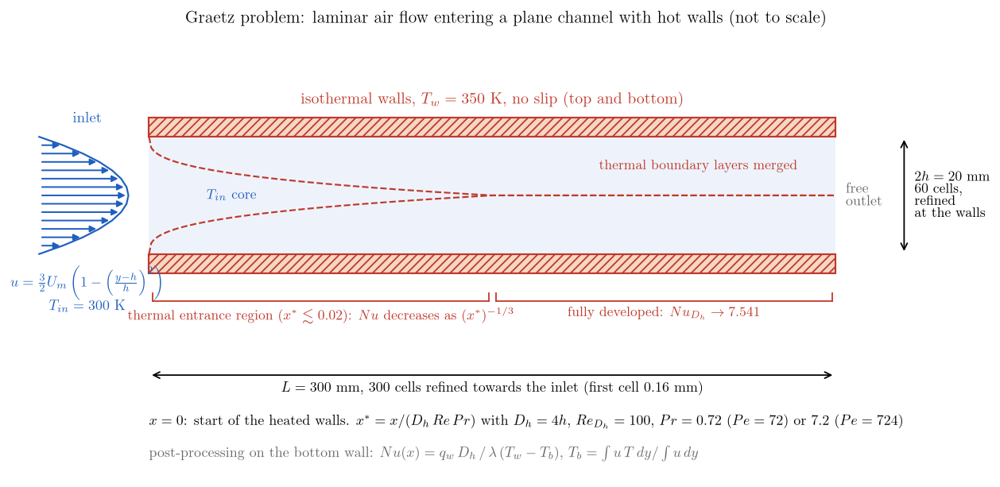
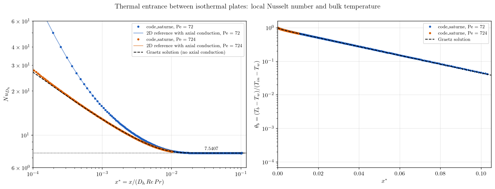

# Thermal Entrance Between Isothermal Plates (Graetz Problem)

A tutorial on **forced-convection heat transfer** with **code_saturne**: a fully developed laminar flow enters a plane channel whose walls are suddenly held at a higher temperature. The local **Nusselt number** decreases along the wall from the entrance singularity to its fully developed value, $Nu = 7.541$ for isothermal plates. The computed $Nu(x)$ is validated against the classical **Graetz solution** and against a two-dimensional reference that keeps the **axial conduction**, which matters at the Péclet number of the main run. The post-processing of the wall heat flux and of the bulk temperature is done in a short user routine.

Maintained by [Simvia](https://Simvia.tech/fr), part of the
[tutoriel-code_saturne](https://github.com/simvia-tech/tutorials-code_saturne) collection.

## Learning objectives

After completing this tutorial you will be able to:

1. Set up a **heated laminar channel** from the GUI: temperature scalar, isothermal walls, a **Poiseuille inlet profile** written as a formula with notebook variables, and a steady solution with local time stepping.
2. Compute a **local Nusselt number** in `cs_user_extra_operations.cpp` from the wall heat flux of the solver and the bulk temperature of each cross-section.
3. Validate a thermal entrance against the **Graetz solution** and know when **axial conduction** invalidates it (Péclet number below about 100).

## Prerequisites

| Requirement | Detail |
|---|---|
| code_saturne | **v9.1** |
| Case | [Th_Balance_By_Zone](../Th_Balance_By_Zone) (heated channel, temperature scalar), [Inc_Laminar_Step](../../00_foundations/Inc_Laminar_Step) |
| Background | Convective heat transfer, Nusselt number, thermal entrance length |

If code_saturne is not yet installed, build it from the
[official homepage](https://code-saturne.org/), pull a
ready-to-use Singularity image from the
[Open Simulation Center](https://open-simulation-center.org/downloads/code_saturne/code_saturne),
or pull the
[Simvia Docker image](https://hub.docker.com/r/Simvia/code_saturne) before continuing.

## Case files

```
Th_Graetz_Entrance/
├── CASE/
│   ├── DATA/
│   │   └── setup.xml                      # mesh, boundaries, properties, notebook, steady algorithm
│   └── SRC/
│       └── cs_user_extra_operations.cpp   # local Nusselt number along the bottom wall
├── FIGURES/
└── README.md
```

> No MESH directory: the mesh is generated at run time by the cartesian mesher. The user routine is only a post-processing: the physics is entirely set in the GUI.

## Physical model

Air with constant properties ($\rho = 1.2$ kg/m³, $\mu = 1.8 \times 10^{-5}$ Pa.s, $c_p = 1005$ J/kg/K, $\lambda = 0.025$ W/m/K, $Pr = 0.724$) flows between two plates separated by $2h = 20$ mm. The velocity profile is the fully developed Poiseuille profile from the inlet, $u(y) = \tfrac{3}{2} U_m \left(1 - ((y-h)/h)^2\right)$ with $U_m = 0.0375$ m/s, so that $Re_{D_h} = \rho U_m D_h/\mu = 100$ with the hydraulic diameter $D_h = 4h$. The fluid enters at $T_{in} = 300$ K and both walls are held at $T_w = 350$ K from $x = 0$.

The steady energy equation, $\rho c_p\, u\, \partial_x T = \lambda\,(\partial_{xx} T + \partial_{yy} T)$, is characterized by the dimensionless abscissa and the local Nusselt number

$$
x^* = \frac{x}{D_h\, Re\, Pr},
\qquad
Nu(x) = \frac{q_w(x)\, D_h}{\lambda\,\left(T_w - T_b(x)\right)},
\qquad
T_b(x) = \frac{\int u\, T\, dy}{\int u\, dy},
$$

where $q_w$ is the wall heat flux and $T_b$ the bulk (mixing-cup) temperature.

**Graetz solution.** Neglecting axial conduction ($\partial_{xx} T$), the problem depends on $x^*$ only. $Nu$ behaves as $(x^*)^{-1/3}$ near the entrance (Lévêque) and tends to $Nu = 7.5407$ for isothermal plates (Shah and London, 1978) beyond $x^* \approx 0.02$; the bulk temperature decays exponentially. The reference curve used here is computed by marching the Graetz equation in $x^*$ with an implicit scheme on a fine grid (not shipped).

**Axial conduction.** The Graetz solution is the limit $Pe = Re\, Pr \to \infty$. At $Pe = 72$, heat also conducts upstream against the flow over a length of order $D_h/Pe$: the wall flux near the entrance is larger and part of the heat leaves through the inlet, where the temperature is imposed. A second reference solves the full two-dimensional equation with the same boundary conditions by finite differences (1200 × 200 points, not shipped). A second run with $\lambda$ divided by ten ($Pr = 7.24$, $Pe = 724$) shows the return to the Graetz solution.

## Geometry and boundary conditions

<p align="center">
  
  <br>
  <em>Figure 1: The case. A fully developed laminar flow at $T_{in}$ enters a plane channel whose walls are held at $T_w$ from $x = 0$; the thermal boundary layers grow from the entrance until they merge, after which the Nusselt number is constant.</em>
</p>

The domain is $0.3 \times 0.02 \times 0.005$ m meshed with $300 \times 60 \times 1$ cells, with a geometric refinement towards the inlet in $x$ (first cell $0.16$ mm, ratio $1.01$) and a parabolic refinement towards the walls in $y$.

| Boundary | Nature | Condition |
|---|---|---|
| `inlet` (`X0`) | Inlet | velocity norm formula `u_norm = 1.5*u_mean*(1 - ((y-h)/h)^2)`, $T = 300$ K |
| `outlet` (`X1`) | Outlet | free outlet |
| `bottom_wall`, `top_wall` (`Y0`, `Y1`) | Wall | no slip, $T = 350$ K |
| `front`, `back` (`Z0`, `Z1`) | Symmetry | |

The inlet formula uses the notebook variables `u_mean` and `h`; the conductivity is a user law equal to the notebook variable `lambda`, so that the Péclet number can be changed from the command line.

## Numerical setup

| Setting | Value |
|---|---|
| Flow | laminar, incompressible, constant properties |
| Thermal scalar | temperature (K), 2nd-order centred convection |
| Steady algorithm | local (pseudo) time step, reference $0.01$ s, SIMPLEC, $4000$ iterations |
| Temperature bounds | none ($0$ to $10^{12}$ K) |
| Post-processing | `cs_user_extra_operations.cpp`: $Nu(x)$, $q_w$, $T_b$ and $\theta_b$ on the bottom wall at the last iteration, written to `nusselt_bottom_wall.csv` |

> **A trap inherited from templates.** A temperature variable carries clipping bounds in the GUI (**Numerical parameters > Equation parameters**). A case derived from another one can keep bounds that do not fit the new temperatures: the temperature is then clipped silently, and here the Nusselt number was wrong by a factor of five before the bound was widened. Check the `Clippings` section of `run_solver.log`.

The user routine reads the wall heat flux from the `boundary_thermal_flux` function of code_saturne (the flux actually used by the solver, counted positive when it leaves the fluid), groups the cells of the cartesian mesh by columns to form the bulk temperature, and writes one line per wall face.

## Running the simulation

```bash
cd Th_Graetz_Entrance/CASE

# run 1: Pe = 72 (air, lambda = 0.025 W/m/K)
code_saturne run --id pe72

# run 2: Pe = 724 (lambda divided by ten)
code_saturne run --notebook-args lambda=0.0025 --id pe724
```

Each run takes about three minutes in serial and writes `run_solver.log`, `nusselt_bottom_wall.csv` and the EnSight output. The user routine is written for a serial run.

## Results and verification

<p align="center">
  
  <br>
  <em>Figure 2: Local Nusselt number (left, log-log) and bulk temperature (right) along the wall for $Pe = 72$ (blue) and $Pe = 724$ (orange), code_saturne (dots) against the two-dimensional references with axial conduction (solid) and the Graetz solution (dashed).</em>
</p>

| $x^*$ | $Nu$, $Pe = 72$ | 2D reference | Graetz | $Nu$, $Pe = 724$ | 2D reference |
|---|---|---|---|---|---|
| $5 \times 10^{-4}$ | $23.77$ | $23.84$ | $15.87$ | $15.97$ | $15.98$ |
| $10^{-3}$ | $15.69$ | $15.70$ | $12.84$ | $12.87$ | $12.88$ |
| $2 \times 10^{-3}$ | $11.55$ | $11.56$ | $10.55$ | $10.56$ | $10.56$ |
| $5 \times 10^{-3}$ | $8.76$ | $8.76$ | $8.52$ | $8.51$ | $8.52$ |
| $10^{-2}$ | $7.80$ | $7.81$ | $7.74$ | $7.73$ | $7.74$ |
| $x^* > 0.03$ (developed) | $7.531$ | $7.54$ | $7.541$ | | |

- At both Péclet numbers code_saturne follows the two-dimensional reference within $0.3\%$ along the whole wall (second cell excepted), and the bulk temperature within $1\%$.
- The fully developed Nusselt number is $7.531$ at $Pe = 72$, $0.13\%$ below the exact $7.5407$; the thermal entrance ends near $x^* = 0.02$ as in the Graetz solution.
- At $Pe = 72$ the Nusselt number in the entrance is up to $50\%$ above the Graetz solution at $x^* = 5 \times 10^{-4}$, $22\%$ at $10^{-3}$ and $3\%$ at $5 \times 10^{-3}$. This is not a numerical error: it is the axial conduction that the Graetz solution neglects, and it is exactly reproduced by the two-dimensional reference. Refining the mesh near the inlet does not change it.
- At $Pe = 724$ the computed $Nu$ is within $0.6\%$ of the Graetz solution everywhere: the axial conduction has become negligible, which is the usual rule of thumb $Pe > 100$.

## Summary

A laminar heated channel set up from the GUI, with a Poiseuille inlet profile and isothermal walls, reproduces the thermal entrance of the Graetz problem: the local Nusselt number computed by a short user routine from the solver's wall heat flux decreases from the entrance to $7.53$, against $7.54$ exact, and follows a full two-dimensional reference within $0.3\%$. The case also shows, by running the same setup at two Péclet numbers, that the classical Graetz solution is only valid when axial conduction is negligible.

## References

- R.K. Shah, A.L. London. Laminar Flow Forced Convection in Ducts, Academic Press, 1978 (parallel plates, thermal entrance, $Nu_T = 7.5407$).
- W.M. Kays, M.E. Crawford, B. Weigand. Convective Heat and Mass Transfer, 4th edition, McGraw-Hill, 2005 (chapter 8, Graetz problem).
- [code_saturne documentation](https://code-saturne.org/doc/)

## Authors

[Simvia](https://Simvia.tech/fr) - Questions, remarks and requests are welcome.
