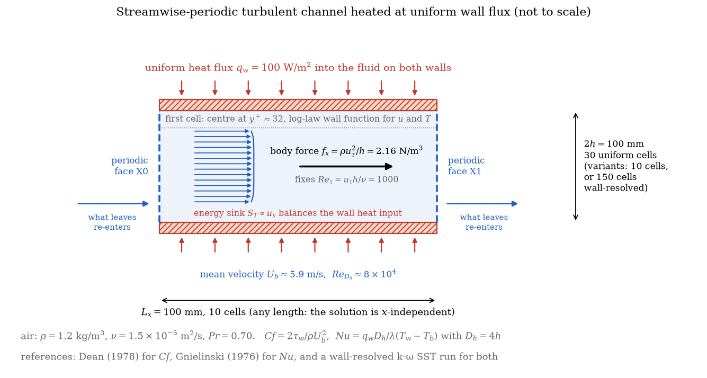
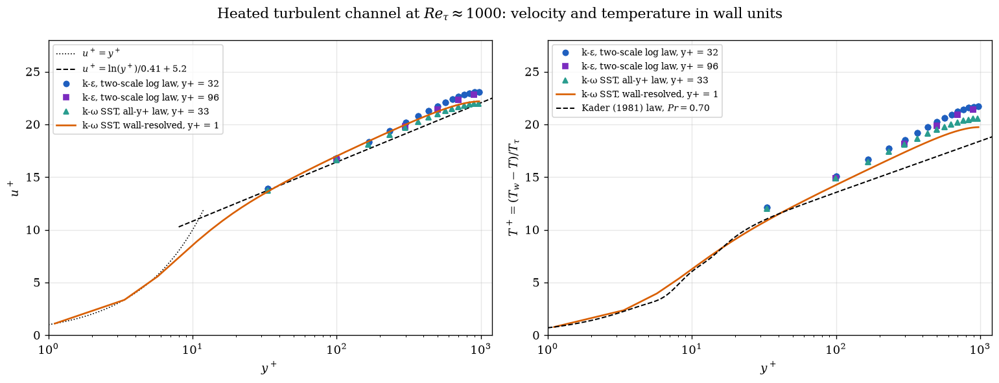

# Turbulent Heated Channel with Wall Functions (Nusselt vs Gnielinski)

The forced-convection series moves to **turbulence**: a fully developed turbulent channel flow heated by a uniform wall flux, computed with the **high-Reynolds approach** of industrial practice, a coarse mesh whose first cell sits in the logarithmic region and **wall functions** for both the velocity and the temperature. The friction coefficient and the Nusselt number are compared with the **Dean** and **Gnielinski** correlations and with a **wall-resolved** computation on the same case. The channel is streamwise-periodic, driven by a body force that fixes the friction Reynolds number, with the energy sink that keeps the periodic temperature steady.

Maintained by [Simvia](https://Simvia.tech/fr), part of the
[tutoriel-code_saturne](https://github.com/simvia-tech/tutorials-code_saturne) collection.

## Learning objectives

After completing this tutorial you will be able to:

1. Set up a **wall-function RANS** computation with heat transfer: $k$-$\varepsilon$ with the two-scale log law, first cell at $y^+ \approx 30$, thermal wall function of the temperature scalar.
2. Build a **streamwise-periodic heated channel**: body force in place of the pressure gradient, uniform wall flux, and the user source term that removes the heat input from the periodic temperature.
3. Compute $Cf$, $y^+$ and $Nu$ from the solver's boundary fields and check them against the **Dean** and **Gnielinski** correlations.
4. Know the **sensitivity** of the result to the wall treatment: $y^+$ of the first cell, log-law or all-$y^+$ wall function, wall-resolved reference.

## Prerequisites

| Requirement | Detail |
|---|---|
| code_saturne | **v9.1** |
| Cases | [Inc_Turbulent_Channel](../../10_turbulence_rans/Inc_Turbulent_Channel) (periodic channel, body force), [Inc_Streamwise_Periodic](../../00_foundations/Inc_Streamwise_Periodic) (periodic temperature with a source term), [Th_Uniform_Flux_Channel](../Th_Uniform_Flux_Channel) |
| Background | Law of the wall, wall functions, turbulent heat transfer correlations |

If code_saturne is not yet installed, build it from the
[official homepage](https://code-saturne.org/), pull a
ready-to-use Singularity image from the
[Open Simulation Center](https://open-simulation-center.org/downloads/code_saturne/code_saturne),
or pull the
[Simvia Docker image](https://hub.docker.com/r/Simvia/code_saturne) before continuing.

## Case files

```
Th_Turbulent_Heated_Channel/
├── CASE/
│   ├── DATA/
│   │   └── setup.xml                      # mesh, periodicity, body force, turbulence, thermal scalar
│   └── SRC/
│       ├── cs_user_source_terms.cpp       # energy sink of the periodic temperature
│       └── cs_user_extra_operations.cpp   # Cf, y+, Nu and wall-normal profiles
├── FIGURES/
└── README.md
```

> No MESH directory: the mesh is generated at run time by the cartesian mesher. The source-term routine is mandatory (periodic temperature); the other one is a post-processing.

## Physical model

Air with constant properties ($\rho = 1.2$ kg/m³, $\nu = 1.5 \times 10^{-5}$ m²/s, $c_p = 1005$ J/kg/K, $\lambda = 0.0257$ W/m/K, $Pr = 0.70$) flows between two parallel walls separated by $2h = 100$ mm. The flow is **fully developed** and **streamwise-periodic**: the velocity field repeats itself, while the pressure drops and the temperature rises linearly along $x$ (Patankar, Liu and Sparrow, 1977). The two linear drifts become source terms of the periodic problem:

- the **momentum** receives the body force $f_x = \rho u_\tau^2/h = 2.16$ N/m³, which fixes the wall shear stress $\tau_w = f_x h$ and the friction Reynolds number $Re_\tau = u_\tau h/\nu = 1000$ ($u_\tau = 0.3$ m/s); the bulk velocity is a result, $U_b \approx 5.9$ m/s, $Re_{D_h} = U_b D_h/\nu \approx 8 \times 10^{4}$ with $D_h = 4h$;
- the **energy** receives a sink equal to the heat input of the walls, weighted by the local streamwise velocity, so that the periodic temperature $\tilde{T}$ is statistically steady; the Nusselt number only involves differences of $\tilde{T}$ and is unaffected by the drift.

Both walls transfer $q_w = 100$ W/m² to the fluid. The quantities compared with the references are

$$
Cf = \frac{2\tau_w}{\rho U_b^2},
\qquad
Nu = \frac{q_w D_h}{\lambda\,(T_w - T_b)},
\qquad
T_b = \frac{\int u\,T\,dy}{\int u\,dy}.
$$

**References.** Dean's correlation for plane channels, $Cf = 0.073\,Re_{2h}^{-1/4}$, and Gnielinski's correlation for the Nusselt number, $Nu = (f/8)(Re_{D_h} - 1000)Pr / \left(1 + 12.7\sqrt{f/8}\,(Pr^{2/3} - 1)\right)$ with $f = (0.79\ln Re_{D_h} - 1.64)^{-2}$, both with an uncertainty of about $\pm 10\%$ (Gnielinski is a pipe correlation applied with $D_h$). A **wall-resolved $k$-$\omega$ SST** run of the same case ($y^+ = 1$, 150 cells) serves as the internal reference.

**Wall functions.** With the first cell centre at $y^+ \approx 30$, the wall shear stress and the wall heat flux are not computed from the resolved gradients but from the logarithmic laws: the two-scale log law of code_saturne for the velocity (friction velocity from the turbulent kinetic energy, $u_k = C_\mu^{1/4} k^{1/2}$) and the Arpaci-Larsen thermal law for the temperature, the default for scalars. The log-law wall function requires the first cell in the logarithmic region, $30 \lesssim y^+ \lesssim 300$.

## Geometry and boundary conditions

<p align="center">
  
  <br>
  <em>Figure 1: The case. A streamwise-periodic channel driven by a body force, heated by a uniform flux, with the first cell in the logarithmic region.</em>
</p>

The domain is $0.1 \times 0.1 \times 0.01$ m meshed with $10 \times 30 \times 1$ **uniform** cells: the first cell centre is at $1.67$ mm from the wall, $y^+ = 32$. The streamwise length is arbitrary.

| Boundary | Nature | Condition |
|---|---|---|
| `X0`, `X1` | Translational periodicity | |
| `walls` (`Y0`, `Y1`) | Wall | no slip, temperature prescribed flux $-100$ W/m² (heating) |
| `Z0`, `Z1` | Symmetry | |

The body force is entered in the GUI as a momentum source term on the volume zone (`Su = 2.16;`). The initial velocity is $6$ m/s and the initial temperature $300$ K.

## Numerical setup

| Setting | Value |
|---|---|
| Turbulence | $k$-$\varepsilon$ linear production, wall function **two-scale log law** (option 3 in the GUI) |
| Thermal scalar | temperature, SGDH turbulent flux with the default turbulent Prandtl number $\sigma_t = 1$, Arpaci-Larsen thermal wall function (default, reported as `iwalfs` in `setup.log`) |
| Steady algorithm | local (pseudo) time step, reference $0.01$ s, SIMPLEC, $10000$ iterations |
| Energy sink | `cs_user_source_terms.cpp`, $S_T = q_w A_w/V \times u_x/\langle u_x \rangle$ |
| Post-processing | `cs_user_extra_operations.cpp`: $U_b$, $T_b$, wall averages of $T_w$, $\tau_w$, $y^+$, $q_w$, then $Cf$, $Re_{D_h}$, $Nu$ in `channel_summary.csv`; profiles of one column of cells in `profiles.csv` |

The run takes about ten seconds in serial.

### Variants used in the comparison

Three variants of the shipped case are reported below; each is one or two edits in the GUI:

| Variant | Edit |
|---|---|
| first cell at $y^+ = 96$ | **Mesh > Cartesian mesh**: 10 cells in $y$ instead of 30 |
| $k$-$\omega$ SST with the all-$y^+$ wall function | **Turbulence models**: $k$-$\omega$ SST, wall function "All y+ (2-scale model)" |
| wall-resolved $k$-$\omega$ SST (reference) | same model, wall function "No wall function", 150 cells in $y$ with the parabolic law and ratio $1.04$ |

## Running the simulation

```bash
cd Th_Turbulent_Heated_Channel/CASE
code_saturne run
```

The run writes `run_solver.log` (the summary line `Channel summary: ...` at the end), `channel_summary.csv`, `profiles.csv` and the EnSight output. The routines are written for a serial run.

## Results and verification

| Wall treatment | $y^+$ | $Re_{D_h}$ | $Cf$ | Dean | $Nu$ | Gnielinski | $T_w - T_b$ [K] |
|---|---|---|---|---|---|---|---|
| $k$-$\varepsilon$, log-law wall function (shipped case) | $32$ | $83100$ | $0.00464$ | $0.00511$ ($-9\%$) | $143.9$ | $155.1$ ($-7\%$) | $5.41$ |
| $k$-$\varepsilon$, log-law wall function, coarser | $96$ | $82100$ | $0.00471$ | $0.00513$ ($-8\%$) | $145.3$ | $153.6$ ($-5\%$) | $5.36$ |
| $k$-$\omega$ SST, all-$y^+$ wall function | $33$ | $80000$ | $0.00497$ | $0.00516$ ($-4\%$) | $149.2$ | $150.5$ ($-1\%$) | $5.22$ |
| $k$-$\omega$ SST, wall-resolved (reference) | $1$ | $80200$ | $0.00491$ | $0.00516$ ($-5\%$) | $155.2$ | $150.9$ ($+3\%$) | $5.01$ |

- The friction Reynolds number is recovered exactly by every run ($Re_\tau = 1000$, the body force fixes $\tau_w$); what differs between wall treatments is the bulk velocity, hence $Cf$ and $Re_{D_h}$.
- The **wall-function $k$-$\varepsilon$** gives $Cf$ and $Nu$ within $7$ to $9\%$ of the correlations, on the low side, and within $5\%$ of the wall-resolved reference for $Cf$ and $7\%$ for $Nu$: the usual accuracy of the high-Reynolds approach. Moving the first cell from $y^+ = 32$ to $96$ changes the results by $1$ to $2\%$: the method is **insensitive to the mesh** as long as the first cell stays in the logarithmic region, which is its purpose.
- The **all-$y^+$ wall function with $k$-$\omega$ SST** on the same coarse mesh is within $1\%$ of Gnielinski and $4\%$ of Dean.
- The **wall-resolved** reference itself sits $5\%$ below Dean and $3\%$ above Gnielinski: the correlations carry their own uncertainty, and the spread between all four results, about $8\%$ on $Nu$, is the realistic accuracy of RANS heat transfer on this configuration.

<p align="center">
  
  <br>
  <em>Figure 2: Mean velocity (left) and temperature (right) in wall units for the four wall treatments, against the logarithmic law of the wall and the thermal law of Kader (1981).</em>
</p>

The wall-function runs have no point below $y^+ = 30$: their first cell sits on the logarithmic law by construction, and the profiles above it follow the law of the wall and the wall-resolved profile. The temperature profiles depart from Kader's law in the outer region ($y^+ > 100$), where the channel core is not a boundary layer; the four treatments agree there within $1$ $T^+$ unit, the $k$-$\varepsilon$ runs being slightly above the SST ones, which is the $7\%$ difference in $Nu$.

## Summary

A streamwise-periodic turbulent channel heated at uniform flux, computed with $k$-$\varepsilon$ and wall functions on a 300-cell mesh in ten seconds, gives the friction coefficient and the Nusselt number within $7$ to $9\%$ of the Dean and Gnielinski correlations and is insensitive to the first-cell $y^+$ between $30$ and $100$. The all-$y^+$ wall function of $k$-$\omega$ SST does better on the same mesh, and a wall-resolved run brackets the correlations from the other side: the tutorial gives the order of magnitude of the accuracy to expect from RANS wall treatments on heat transfer, and the workflow to check it.

## References

- S.V. Patankar, C.H. Liu, E.M. Sparrow. Fully developed flow and heat transfer in ducts having streamwise-periodic variations of cross-sectional area, [Journal of Heat Transfer, 99:180-186, 1977](https://doi.org/10.1115/1.3450666).
- V. Gnielinski. New equations for heat and mass transfer in turbulent pipe and channel flow, International Chemical Engineering, 16:359-368, 1976.
- R.B. Dean. Reynolds number dependence of skin friction and other bulk flow variables in two-dimensional rectangular duct flow, [Journal of Fluids Engineering, 100:215-223, 1978](https://doi.org/10.1115/1.3448633).
- B.A. Kader. Temperature and concentration profiles in fully turbulent boundary layers, [International Journal of Heat and Mass Transfer, 24:1541-1544, 1981](https://doi.org/10.1016/0017-9310(81)90220-9).
- [code_saturne documentation](https://code-saturne.org/doc/)

## Authors

[Simvia](https://Simvia.tech/fr) - Questions, remarks and requests are welcome.
