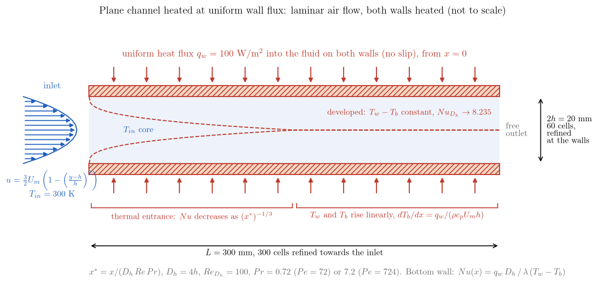
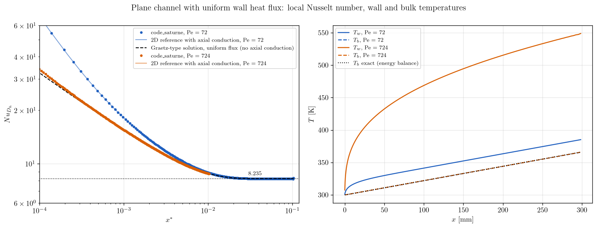

# Channel Heated at Uniform Wall Flux (Nusselt 8.235)

The second tutorial of the forced-convection series: the same laminar channel as the [Graetz entrance](../Th_Graetz_Entrance), now heated by a **uniform heat flux** on both walls instead of an imposed temperature. This is the other canonical thermal boundary condition, and the one that electrical heating, nuclear fuel or solar collectors impose. The bulk temperature rises **linearly** with the exact slope of the energy balance, the wall temperature follows it at a constant distance once the flow is thermally developed, and the local Nusselt number tends to $Nu = 8.235$ for parallel plates. The computed $Nu(x)$ is validated against the Graetz-type solution for uniform flux and against a two-dimensional reference with axial conduction.

Maintained by [Simvia](https://Simvia.tech/fr), part of the
[tutoriel-code_saturne](https://github.com/simvia-tech/tutorials-code_saturne) collection.

## Learning objectives

After completing this tutorial you will be able to:

1. Impose a **wall heat flux** on the temperature scalar from the GUI, and know its **sign convention** (positive flux leaves the fluid).
2. Check a heated flow against the **energy balance** (linear rise of the bulk temperature) before any finer validation.
3. Compute the local Nusselt number with the **wall temperature given by the solver**, and recognize the fully developed state by a constant wall-to-bulk temperature difference.

## Prerequisites

| Requirement | Detail |
|---|---|
| code_saturne | **v9.1** |
| Case | [Th_Graetz_Entrance](../Th_Graetz_Entrance) (same setup with isothermal walls, post-processing routine) |
| Background | Convective heat transfer, Nusselt number, energy balance of a duct |

If code_saturne is not yet installed, build it from the
[official homepage](https://code-saturne.org/), pull a
ready-to-use Singularity image from the
[Open Simulation Center](https://open-simulation-center.org/downloads/code_saturne/code_saturne),
or pull the
[Simvia Docker image](https://hub.docker.com/r/Simvia/code_saturne) before continuing.

## Case files

```
Th_Uniform_Flux_Channel/
├── CASE/
│   ├── DATA/
│   │   └── setup.xml                      # mesh, boundaries, properties, notebook, steady algorithm
│   └── SRC/
│       └── cs_user_extra_operations.cpp   # local Nusselt number along the bottom wall
├── FIGURES/
└── README.md
```

> No MESH directory: the mesh is generated at run time by the cartesian mesher. The user routine is only a post-processing.

## Physical model

Air with constant properties ($\rho = 1.2$ kg/m³, $\mu = 1.8 \times 10^{-5}$ Pa.s, $c_p = 1005$ J/kg/K, $\lambda = 0.025$ W/m/K) enters a plane channel of gap $2h = 20$ mm with the Poiseuille profile, $U_m = 0.0375$ m/s, $Re_{D_h} = 100$ with $D_h = 4h$, at $T_{in} = 300$ K. From $x = 0$ both walls transfer a uniform flux $q_w = 100$ W/m² to the fluid.

**Energy balance.** Whatever the Péclet number and the state of the thermal boundary layers, the heat received up to $x$ is $2 q_w x$ per unit depth, so the bulk temperature rises linearly:

$$
T_b(x) = T_{in} + \frac{q_w\, x}{\rho\, c_p\, U_m\, h},
\qquad
\frac{dT_b}{dx} = 0.221\ \mathrm{K/mm}.
$$

**Local Nusselt number.** With $T_w(x)$ the wall temperature, $Nu(x) = q_w D_h/(\lambda\,(T_w - T_b))$. For uniform flux ("H" condition) the Graetz-type solution gives $Nu \to 8.235$ (Shah and London, 1978), reached beyond $x^* = x/(D_h Re Pr) \approx 0.02$; in the developed region $T_w - T_b = q_w D_h/(8.235\,\lambda) = 19.4$ K is constant and the wall temperature rises with the same slope as $T_b$. The reference curve is computed by marching the energy equation without axial conduction with the Neumann wall condition (not shipped).

**Axial conduction.** As in the Graetz tutorial, at $Pe = 72$ the axial conduction raises the Nusselt number in the entrance region; a two-dimensional reference with axial conduction (1200 × 200 points, not shipped) and a second run at $Pe = 724$ ($\lambda$ divided by ten) quantify it.

## Geometry and boundary conditions

<p align="center">
  
  <br>
  <em>Figure 1: The case. The flux enters through both walls from $x = 0$; after the thermal entrance the wall and bulk temperatures rise in parallel.</em>
</p>

Same domain and mesh as the Graetz tutorial: $0.3 \times 0.02 \times 0.005$ m, $300 \times 60 \times 1$ cells refined towards the inlet and the walls.

| Boundary | Nature | Condition |
|---|---|---|
| `inlet` (`X0`) | Inlet | velocity norm formula `u_norm = 1.5*u_mean*(1 - ((y-h)/h)^2)`, $T = 300$ K |
| `outlet` (`X1`) | Outlet | free outlet |
| `bottom_wall`, `top_wall` (`Y0`, `Y1`) | Wall | no slip, temperature **prescribed flux** $-100$ W/m² |
| `front`, `back` (`Z0`, `Z1`) | Symmetry | |

> **Sign of the prescribed flux.** In the GUI thermal condition of a wall, the prescribed flux is counted **positive when it leaves the fluid**: a wall that heats the fluid at $100$ W/m² is entered as $-100$. With $+100$ the fluid cools down to $215$ K at the outlet, with the same Nusselt number. The value must be a number: a notebook variable is not evaluated in this field.

## Numerical setup

| Setting | Value |
|---|---|
| Flow and thermal scalar | laminar, constant properties, temperature with 2nd-order centred convection |
| Steady algorithm | local (pseudo) time step, reference $0.01$ s, SIMPLEC, $4000$ iterations |
| Conductivity | user law equal to the notebook variable `lambda` ($0.025$ or $0.0025$ W/m/K) |
| Post-processing | `cs_user_extra_operations.cpp`: $q_w$, $T_w$, $T_b$, exact $T_b$ and $Nu$ on the bottom wall at the last iteration, in `nusselt_bottom_wall.csv` |

The routine reads the wall heat flux from the `boundary_thermal_flux` function of the solver, which must return the imposed value, the wall temperature from the `boundary_temperature` field, and forms the bulk temperature of each column of cells.

## Running the simulation

```bash
cd Th_Uniform_Flux_Channel/CASE

# run 1: Pe = 72 (air)
code_saturne run --id pe72

# run 2: Pe = 724 (lambda divided by ten)
code_saturne run --notebook-args lambda=0.0025 --id pe724
```

Each run takes about three minutes in serial and writes `run_solver.log`, `nusselt_bottom_wall.csv` and the EnSight output. The routine is written for a serial run.

## Results and verification

<p align="center">
  
  <br>
  <em>Figure 2: Local Nusselt number (left) for $Pe = 72$ (blue) and $Pe = 724$ (orange), code_saturne (dots) against the two-dimensional references (solid) and the Graetz-type solution (dashed); wall and bulk temperatures along the channel (right) with the exact bulk temperature (dotted).</em>
</p>

- **Energy balance.** The computed bulk temperature follows the exact linear law within $0.4$ K over a rise of $66$ K, at both Péclet numbers, and the wall flux returned by the solver is exactly $100$ W/m² on every face.
- **Developed state.** At $Pe = 72$ the Nusselt number is constant beyond $x^* \approx 0.02$ at $Nu = 8.225$, $0.12\%$ below the exact $8.235$; the wall-to-bulk difference at $x = 250$ mm is $19.5$ K against $19.4$ K.
- **Entrance region.** At $Pe = 72$ the code follows the two-dimensional reference within $1.5\%$ and exceeds the Graetz-type solution by $17\%$ at $x^* = 10^{-3}$ because of axial conduction; at $Pe = 724$ it follows both references within $0.5\%$.

| $x^*$ | $Nu$, $Pe = 72$ | 2D reference | Graetz-type (H) | $Nu$, $Pe = 724$ |
|---|---|---|---|---|
| $10^{-3}$ | $18.13$ | $18.14$ | $15.44$ | $15.50$ |
| $5 \times 10^{-3}$ | $10.30$ | $10.31$ | $9.99$ | $9.99$ |
| $10^{-2}$ | $8.91$ | $8.91$ | $8.80$ | $8.80$ |
| $x^* > 0.03$ (developed) | $8.225$ | $8.24$ | $8.235$ | |

## Summary

With the wall condition switched from an imposed temperature to an imposed flux, the same laminar channel gives the linear rise of the bulk temperature of the energy balance, a constant wall-to-bulk difference once the flow is developed, and the exact Nusselt number $8.235$ to $0.1\%$. The GUI flux is counted positive out of the fluid, which is the one thing to remember from this case. Together with the Graetz tutorial it provides the two reference boundary conditions of duct heat transfer.

## References

- R.K. Shah, A.L. London. Laminar Flow Forced Convection in Ducts, Academic Press, 1978 (parallel plates, $Nu_H = 8.235$).
- F.P. Incropera, D.P. DeWitt, T.L. Bergman, A.S. Lavine. Fundamentals of Heat and Mass Transfer, 6th edition, Wiley, 2007 (chapter 8, internal flow, constant heat flux).
- [code_saturne documentation](https://code-saturne.org/doc/)

## Authors

[Simvia](https://Simvia.tech/fr) - Questions, remarks and requests are welcome.
