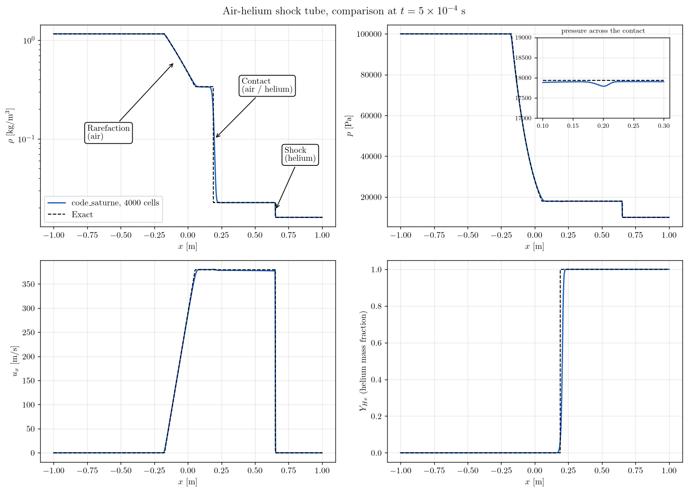

# Air-Helium Shock Tube (Ideal Gas Mixture)

A tutorial on the **ideal gas mixture** equation of state of the **compressible module** of **code_saturne**: a shock tube filled with air on one side and helium on the other. The species mass fractions are transported with the flow, the local heat capacity ratio follows the composition, and the solution is validated against the **exact Riemann solution for two gases with different $\gamma$**. The case is the standard check that a compressible scheme does not generate spurious pressure oscillations at an interface between two gases.

There is no reaction and no phase change: the two gases are miscible and perfectly mixed in each cell. The two-phase steam-water cases of this series use another model ([Comp_Two_Phase_Shock_Tube](../Comp_Two_Phase_Shock_Tube)).

Maintained by [Simvia](https://Simvia.tech/fr), part of the
[tutoriel-code_saturne](https://github.com/simvia-tech/tutorials-code_saturne) collection.

## Learning objectives

After completing this tutorial you will be able to:

1. Activate the **gas mix model** with the compressible module and understand which species are solved and which one is deduced.
2. Initialize a compressible case by **pressure, temperature and composition**, the density and energy being deduced by the mixture thermodynamics.
3. Validate a two-gas Riemann problem against its **exact solution**, including the contact wave across which $\gamma$ jumps.
4. Know the two **workarounds needed in v9.1** to run the gas mix with the compressible module.

## Prerequisites

| Requirement | Detail |
|---|---|
| code_saturne | **v9.1** |
| Case | [Comp_Sod_Tube](../Comp_Sod_Tube) (compressible module, cartesian mesh, fixed time step) |
| Background | Gas dynamics, Riemann problem |

If code_saturne is not yet installed, build it from the
[official homepage](https://code-saturne.org/), pull a
ready-to-use Singularity image from the
[Open Simulation Center](https://open-simulation-center.org/downloads/code_saturne/code_saturne),
or pull the
[Simvia Docker image](https://hub.docker.com/r/Simvia/code_saturne) before continuing.

## Case files

```
Comp_Helium_Air_Shock_Tube/
├── CASE/
│   ├── DATA/
│   │   └── setup.xml                      # mesh, time stepping, 1D profile output
│   └── SRC/
│       ├── cs_user_parameters.cpp         # gas mix activation, EOS, variable cp, v9.1 workaround
│       └── cs_user_initialization.cpp     # left and right states (p, T, composition)
├── FIGURES/
└── README.md
```

> No MESH directory: the mesh is generated at run time by the cartesian mesher. The gas mix model has no GUI panel, so the two user routines are mandatory.

## Physical model

The flow obeys the Euler equations for a **mixture of ideal gases**. With the air/helium option of the gas mix model, the mass fractions of O₂ and N₂ are solved as transported scalars and the helium mass fraction is deduced, $Y_{He} = 1 - Y_{O_2} - Y_{N_2}$. The mixture properties follow from the composition, $c_p = \sum_k Y_k c_{p,k}$ and $1/M = \sum_k Y_k/M_k$, hence $c_v = c_p - R/M$ and $\gamma = c_p/c_v$ vary from cell to cell. The compressible module uses them through its ideal gas mix equation of state, $p = \rho (R/M)\, T$.

| Species | $M$ [kg/mol] | $c_p$ [J/kg/K] | Source |
|---|---|---|---|
| O₂ | $0.032$ | $930$ | gas mix model |
| N₂ | $0.028$ | $1042$ | gas mix model |
| He | $0.004$ | $5194$ | gas mix model |

Air is $Y_{O_2} = 0.233$, $Y_{N_2} = 0.767$ by mass, which gives $\gamma_{air} = 1.396$ and $c_{air} = 347.5$ m/s at $300$ K; helium gives $\gamma_{He} = 1.667$ and $c_{He} = 1019.6$ m/s.

### The Riemann problem

| State | Gas | $p$ [Pa] | $T$ [K] | $\rho$ [kg/m³] | $u$ [m/s] |
|---|---|---|---|---|---|
| Left ($x < 0$) | air | $10^{5}$ | $300$ | $1.1563$ | $0$ |
| Right ($x \geq 0$) | helium | $10^{4}$ | $300$ | $0.01604$ | $0$ |

The exact solution (iterative two-gas Riemann solver, each side with its own $\gamma$) consists of a **rarefaction in the air**, a **contact wave** separating the two gases, and a **shock in the helium**:

| Quantity | Value |
|---|---|
| Intermediate pressure $p^*$ | $17934.7$ Pa |
| Intermediate velocity $u^*$ | $379.54$ m/s |
| Densities $\rho^*_{air}$, $\rho^*_{He}$ | $0.3377$, $0.02262$ kg/m³ |
| Shock speed | $1303.6$ m/s (Mach $1.28$ in the helium) |
| Positions at $t = 5 \times 10^{-4}$ s | rarefaction $[-0.174, 0.054]$ m, contact $0.190$ m, shock $0.652$ m |

## Geometry and boundary conditions

The domain is a thin box of $2 \times 0.01 \times 1$ m meshed with $4000 \times 1 \times 1$ cells ($\Delta x = 0.5$ mm), a 1D problem on a 3D mesh, with **symmetry planes** on the six faces: no wave reaches the ends before $t_{end}$. The initial states are set in `cs_user_initialization.cpp` by pressure, temperature and composition, with `ithvar = 100000` telling the module that pressure and temperature are the imposed variables.

> **Trace of air in the helium.** The helium side holds $10^{-6}$ of air. Two auxiliary properties of the gas mix model (molar mass of the non-condensable gases, steam binary diffusion) are computed by a division that gives $0/0$ where no solved species is present; they are only used by the wall condensation model, but their NaN values would stop the run.

## Numerical setup

| Setting | Value |
|---|---|
| Model | `CS_GAS_MIX = CS_GAS_MIX_AIR_HELIUM`, `ieos = CS_EOS_GAS_MIX`, `icp = 0`, all set in `cs_user_model` |
| Convection schemes | 1st-order upwind (imposed by the compressible module) |
| Time step | fixed, $10^{-7}$ s, $5000$ iterations, $t_{end} = 5 \times 10^{-4}$ s, CFL $\approx 0.3$ behind the shock |
| Transport properties | computed by the gas mix model (Sutherland laws): $\mu \approx 1.9 \times 10^{-5}$ Pa.s, negligible at this scale |
| 1D output | `profiles` block, CSV at the end, `RESU/<id>/profiles/tube.csv` |

> **Workaround for v9.1.** The gas mix model creates a property field `tempk` and maps the Kelvin temperature pointer to it, overriding the mapping of the compressible module to its solved `temperature` variable. The property update of the gas mix then aborts when it queries the diffusivity of that property. `cs_user_parameters.cpp` restores the mapping with `cs_field_pointer_map`. Without this line the run stops at the first time step.

The zero-viscosity user laws inherited from the Sod tube are overridden by the gas mix model, which imposes its own viscosity and conductivity: the computation is slightly viscous, with no visible effect at this resolution.

## Running the simulation

```bash
cd Comp_Helium_Air_Shock_Tube/CASE
code_saturne run
```

The run takes about one minute in serial and writes `run_solver.log`, `profiles/tube.csv` (density, velocity, pressure, temperature, specific heat and the three mass fractions along the tube) and the EnSight output.

## Results and verification

<p align="center">
  
  <br>
  <em>Figure 1: Density (log scale), pressure, velocity and helium mass fraction at $t = 5 \times 10^{-4}$ s, code_saturne (solid) against the exact solution (dashed). Inset: pressure across the air-helium contact.</em>
</p>

The three waves are reproduced:

- The **shock** is at $x = 0.651$ m (exact $0.652$), the post-shock plateau at $p = 17900$ Pa and $u = 378.4$ m/s (exact $17935$ Pa and $379.5$ m/s).
- The **rarefaction** matches the exact fan.
- The **contact** between the gases is smeared over about $40$ cells (10 to 90 % of the helium fraction between $x = 0.193$ and $0.214$ m, exact position $0.190$ m). The smearing is skewed towards the helium side: the numerical diffusion acts on the conserved $\rho Y_k$, and a small mass of helium mixed into the dense air moves the half-fraction point. The pressure across the contact shows a dip of $0.8\%$ of $p^*$, the classical interface glitch of conservative schemes, here small and not growing.

$L^1$ relative errors over $-0.9 < x < 0.98$ m:

| $\rho$ | $p$ | $u$ | $Y_{He}$ |
|---|---|---|---|
| $3.8 \times 10^{-3}$ | $1.4 \times 10^{-3}$ | $6.2 \times 10^{-3}$ | $1.9 \times 10^{-2}$ |

The errors are those of the smeared contact and shock of a first-order scheme.

## Summary

The gas mix model of code_saturne turns the compressible module into a multi-species solver with a composition-dependent $\gamma$, at the cost of two user routines (no GUI panel) and, in v9.1, of a one-line workaround on the temperature field pointer and a trace of air in the pure helium. The air-helium shock tube matches the exact two-gas Riemann solution: correct shock speed and plateau, no pressure oscillation at the interface beyond a small local dip, and a contact smeared by the upwind scheme.

## References

- E.F. Toro. Riemann Solvers and Numerical Methods for Fluid Dynamics, 3rd edition, Springer, 2009 (chapter 4, exact Riemann solver).
- R. Abgrall, S. Karni. Computations of compressible multifluids, [Journal of Computational Physics, 169:594-623, 2001](https://doi.org/10.1006/jcph.2000.6685).
- [code_saturne documentation](https://code-saturne.org/doc/)

## Authors

[Simvia](https://Simvia.tech/fr) - Questions, remarks and requests are welcome.
