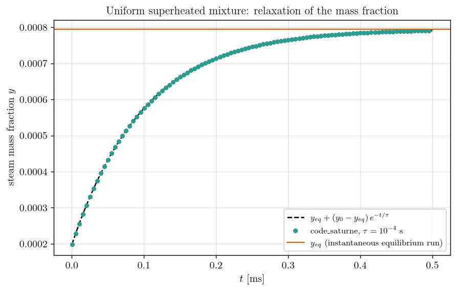
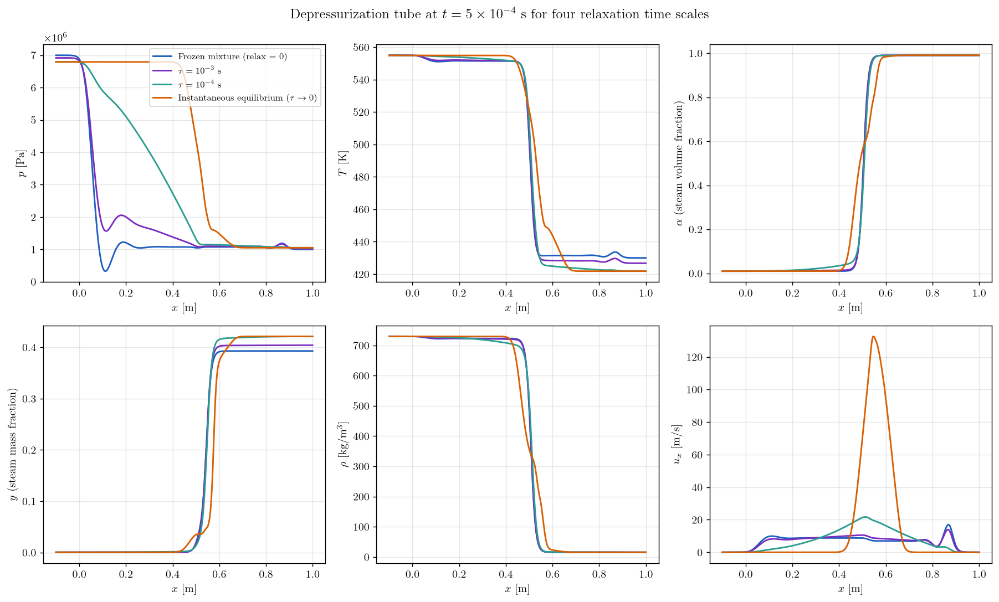
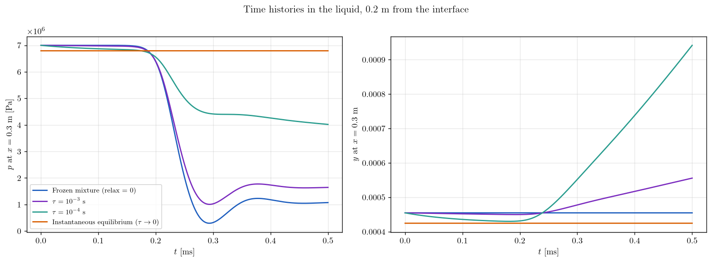

# Depressurization and Flashing of Hot Water (Relaxation Time Scale)

A step-by-step tutorial on the **mass transfer closure** of the **compressible homogeneous two-phase model** of **code_saturne**: a column of hot pressurized water is suddenly put in contact with low-pressure steam, the rarefaction wave brings the liquid below its saturation pressure, and the liquid **flashes**. The same case is run with four relaxation time scales $\tau$, from the frozen mixture to the instantaneous equilibrium, with the user routine that provides $\tau$ to the code. The exponential integration of the relaxation step is verified exactly on a uniform case, and the equilibrium runs are checked against the saturation curve of the model.

This is the second tutorial on this model. Its setup (model activation, equations of state, initialization path) is the one of [Comp_Two_Phase_Shock_Tube](../Comp_Two_Phase_Shock_Tube), which should be read first.

Maintained by [Simvia](https://Simvia.tech/fr), part of the
[tutoriel-code_saturne](https://github.com/simvia-tech/tutorials-code_saturne) collection.

## Learning objectives

After completing this tutorial you will be able to:

1. Write the user routine `cs_user_hgn_thermo_relax_time` that provides the **relaxation time scale** of the homogeneous two-phase model, and drive it from a **notebook variable**.
2. Recognize the three regimes of the model on a flashing flow: **frozen mixture**, **metastable superheated liquid** with a finite $\tau$, **instantaneous equilibrium** at the saturation pressure.
3. Initialize a **two-phase mixture at given pressure, temperature and void fraction** from the phasic laws, and spread an interface with a controlled width.
4. Verify the **exponential integration** of the relaxation step against its exact solution, and verify that the equilibrium state satisfies $T = T_{sat}(p)$.
5. Know a hard limitation of the model in v9.1: a **sharp interface between pure phases** cannot be computed at this density ratio, and why.

## Prerequisites

| Requirement | Detail |
|---|---|
| code_saturne | **v9.1** |
| Case | [Comp_Two_Phase_Shock_Tube](../Comp_Two_Phase_Shock_Tube) (model activation, two-phase EOS, limitations of v9.1) |
| Background | Two-phase thermodynamics (saturation curve, metastable states, flashing) |

If code_saturne is not yet installed, build it from the
[official homepage](https://code-saturne.org/), pull a
ready-to-use Singularity image from the
[Open Simulation Center](https://open-simulation-center.org/downloads/code_saturne/code_saturne),
or pull the
[Simvia Docker image](https://hub.docker.com/r/Simvia/code_saturne) before continuing.

## Case files

```
Comp_Two_Phase_Flashing/
├── CASE/
│   ├── DATA/
│   │   └── setup.xml                      # mesh, time stepping, notebook, probes, 1D profile
│   └── SRC/
│       ├── cs_user_parameters.cpp         # model activation, EOS, stiffened gas parameters
│       ├── cs_user_initialization.cpp     # left and right mixtures, smoothed interface
│       ├── cs_user_hgn.cpp                # relaxation time scale (notebook variable tau)
│       └── cs_user_extra_operations.cpp   # return-to-equilibrium step (notebook switch)
├── FIGURES/                               # figures used in this README
└── README.md
```

> There is **no MESH directory**: the mesh is generated at run time by the cartesian mesher. The four user routines are mandatory. All the physical parameters of the case (states, interface width, relaxation switch and time scale) are **notebook variables** of `setup.xml`, so that the runs of this tutorial only differ by their command line.

## Physical model

### Return to equilibrium

The model and its equations of state are those of the [two-phase shock tube](../Comp_Two_Phase_Shock_Tube#physical-model): a single velocity, one pressure, three transported steam fractions $(\alpha, y, z)$ and one stiffened gas per phase, with the parameters of Helluy, Hurisse and Le Coupanec (2016), representative of steam-water flows around 81 bar. The fractions obey

$$
\partial_t (\rho \phi) + \partial_x (\rho \phi u) = \rho\,\frac{\phi_{eq} - \phi}{\tau},
\qquad \phi \in \{\alpha, y, z\},
$$

where $(\alpha_{eq}, y_{eq}, z_{eq})$ are the fractions for which both phases have the same pressure, temperature and chemical potential at the given internal energy and specific volume of the cell. After the convection step, code_saturne integrates the relaxation exactly on each cell, at constant $\rho$, $u$ and $E$:

$$
\phi^{n+1} = e^{-\Delta t/\tau}\,\phi^{n} + \left(1 - e^{-\Delta t/\tau}\right)\phi_{eq},
$$

then recomputes $p$ and $T$. The time scale $\tau$ is the closure of the model. It is returned cell by cell by the routine `cs_user_hgn_thermo_relax_time`, which receives the equilibrium fractions, the internal energy and the specific volume, so that a closure law may depend on the local state (the skeleton shipped with code_saturne shows laws depending on the void fraction and on the distance to equilibrium). Here a **uniform value** is imposed from the notebook variable `tau`; when `tau = 0` the routine leaves the code default, $\tau = 10^{-30}$ s, which is an instantaneous return to equilibrium.

### The depressurization tube

A closed tube contains hot water with a small steam content on the left and steam at low pressure on the right. The states are mixtures at a common pressure and temperature with a given steam volume fraction; the mass fraction, the specific volume and the internal energy follow from the phasic laws (the steam is phase 1, index 0 in the code):

$$
y = \frac{\alpha/\tau_1}{\alpha/\tau_1 + (1-\alpha)/\tau_2},
\qquad
\tau = y\,\tau_1 + (1-y)\,\tau_2,
\qquad
e = y\,e_1 + (1-y)\,e_2,
\qquad
z = \frac{y\,e_1}{e}.
$$

| State | $p$ [bar] | $T$ [K] | $T_{sat}(p)$ [K] | $\alpha$ | $y$ | $\rho$ [kg/m³] | $c$ [m/s] |
|---|---|---|---|---|---|---|---|
| Left ($x < 0.5$ m), liquid-rich | $70$ | $555$ | $557.3$ | $0.01$ | $4.55 \times 10^{-4}$ | $729.9$ | $925$ |
| Right ($x > 0.5$ m), steam-rich | $10$ | $430$ | $418.7$ | $0.99$ | $0.393$ | $15.4$ | $699$ |

The liquid is $2$ K subcooled and the steam $11$ K superheated: both sides are close to, but not at, equilibrium. When the interface is released, a rarefaction wave travels into the liquid at about $925$ m/s and brings its pressure down towards the steam pressure, far below the saturation pressure of $555$ K water ($68$ bar): the liquid becomes strongly superheated and must vaporize. How fast it does so is precisely what $\tau$ controls.

### Flow parameters

| Quantity | Symbol | Value | Source |
|---|---|---|---|
| Left and right states | `p_left`, `t_left`, `alpha_left`, `p_right`, `t_right`, `alpha_right` | table above | notebook |
| Interface position and width | $x_d$, `xw` | $0.5$ m, $0.02$ m | `cs_user_initialization.cpp`, notebook |
| Relaxation switch and time scale | `relax`, `tau` | $0$/$1$, $0$ or value in s | notebook |
| Domain | $x \in [-1, 2]$ m | $3000$ uniform cells ($\Delta x = 1$ mm) | `mesh_cartesian` |
| Time step | $\Delta t$ | $2.5 \times 10^{-7}$ s (fixed) | `time_step_ref` |
| Final time | $t_{end}$ | $5 \times 10^{-4}$ s ($2000$ iterations) | `iterations` |
| Probes | $x = 0.3$ m and $x = 0.5$ m | every time step | `probes` |

The fixed time step corresponds to an acoustic CFL $(|u|+c)\,\Delta t/\Delta x \approx 0.23$ on the liquid side.

## Geometry and boundary conditions

The domain is a thin box of $3 \times 0.01 \times 1$ m meshed with $3000 \times 1 \times 1$ cells, with **symmetry planes** on its six faces (the two-phase model only supports closed domains in v9.1, see the shock tube tutorial). The tube is long enough for the waves reflected by its ends to stay away from the region of interest at $t_{end}$: the fastest wave, the rarefaction in the liquid, has travelled $0.5$ m.

| Boundary | Nature | Zone / selection |
|---|---|---|
| all six faces | Symmetry | `X0`, `X1`, `Y0`, `Y1`, `Z0`, `Z1` |

The interface is **spread over a width** `xw` $= 2$ cm by a hyperbolic tangent on $(p, T, \alpha)$ before the mixture is built, that is over about twenty cells. This is not a cosmetic choice:

> **A sharp interface between (nearly) pure phases cannot be computed.** With `xw = 0`, and whether the sides are pure phases or the mixtures above, the run stops within a few time steps with a negative pressure, even with a ten times smaller time step. After two time steps the first steam cell holds a density of $19$ kg/m³ together with a steam volume fraction of $0.77$: the three fractions, transported as conserved quantities with the mass flux, and the density, updated by the pressure equation, become inconsistent in the interface cell, and the phasic specific volumes deduced from them give a negative liquid pressure (a stiffened gas with $\Pi = 3.7 \times 10^{8}$ Pa is extremely sensitive to its specific volume). Spreading the interface over five cells is not enough; twenty cells are. A milder case (steam volume fractions $0.05$ and $0.5$, $70$ and $30$ bar) runs with a sharp interface but shows the pure-liquid pocket artifact described in the shock tube tutorial.

## Numerical setup

| Setting | Value | Rationale |
|---|---|---|
| Compressible algorithm | pressure-based, two-phase EOS | as in the shock tube tutorial |
| Convection schemes | 1st-order upwind (all variables) | imposed by the compressible module |
| Time-stepping | **Fixed time step**, $2.5 \times 10^{-7}$ s | time-accurate transient, CFL $\approx 0.23$ |
| Return to equilibrium | applied from `cs_user_extra_operations` when `relax = 1` | the solver does not call it in v9.1 |
| Relaxation time scale | `cs_user_hgn.cpp`, uniform value `tau` | closure of the model |
| Viscosities, conductivity | $0$ (user laws) | Euler limit |
| Outputs | 1D profile at $t_{end}$, two probes every time step | `profiles/tube.csv`, `monitoring/probes_*.csv` |

## Running the simulation

The commands below start from the tutorial directory:

```bash
cd Comp_Two_Phase_Flashing/
```

### Option A: Graphical interface

```bash
code_saturne gui CASE/DATA/setup.xml &
```

The GUI shows the mesh, the time stepping, the notebook variables (**Physical properties > Notebook**), the probes and the profile. The two-phase model and its closure live in `CASE/SRC`. To run a variant from the GUI, edit the value of `relax` or `tau` in the notebook and launch the run with the **gear (Run) button**.

### Option B: Command line

```bash
cd CASE

# run 1: frozen mixture (no mass transfer)
code_saturne run --id frozen

# runs 2 and 3: finite relaxation time scales
code_saturne run --notebook-args relax=1 tau=1e-3 --id tau1e-3
code_saturne run --notebook-args relax=1 tau=1e-4 --id tau1e-4

# run 4: instantaneous equilibrium (code default tau = 1e-30 s)
code_saturne run --notebook-args relax=1 --id equilibrium

# verification of the relaxation step on a uniform superheated mixture
code_saturne run --notebook-args relax=1 p_left=3e6 p_right=3e6 t_left=555 t_right=555 alpha_left=0.01 alpha_right=0.01 xw=0 --id zero_d_eq
code_saturne run --notebook-args relax=1 tau=1e-4 p_left=3e6 p_right=3e6 t_left=555 t_right=555 alpha_left=0.01 alpha_right=0.01 xw=0 --id zero_d_tau
```

Notebook values are passed as space-separated `key=value` pairs. Each run creates `CASE/RESU/<id>/` containing `run_solver.log`, `profiles/tube.csv` (the 1D profile at $t_{end}$), `monitoring/probes_<variable>.csv` (time histories at the two probes) and `postprocessing/` (EnSight Gold, final time). A run takes about $25$ s in serial.

## Results and verification

### Verification of the relaxation step on a uniform mixture

The last two runs start from a uniform mixture at $30$ bar and $555$ K with a steam volume fraction of $0.01$, that is a liquid superheated by $62$ K ($T_{sat}(30\ \mathrm{bar}) = 492.7$ K). Nothing moves, so the only evolution is the relaxation of the fractions at constant $(e, \tau)$. The instantaneous run gives the equilibrium mass fraction $y_{eq} = 7.950 \times 10^{-4}$ from the first time step on, and keeps it. The run with $\tau = 10^{-4}$ s must then follow $y(t) = y_{eq} + (y_0 - y_{eq})\,e^{-t/\tau}$ with $y_0 = 1.970 \times 10^{-4}$.

<p align="center">
  
  <br>
  <em>Figure 1: Steam mass fraction at the probe for the uniform superheated mixture, code_saturne with $\tau = 10^{-4}$ s (dots) against the exact exponential relaxation (dashed) towards the equilibrium value of the instantaneous run (orange).</em>
</p>

The computed mass fraction follows the exact law to $7 \times 10^{-12}$ in absolute value, that is $10^{-8}$ of the jump $y_0 - y_{eq}$: the exponential update is exact, the value of $\tau$ returned by the routine is the one used, and the equilibrium fractions do not drift while $(e, \tau)$ are constant.

### The four regimes of the depressurization

<p align="center">
  
  <br>
  <em>Figure 2: Profiles at $t = 5 \times 10^{-4}$ s for the four relaxation time scales. From top left: pressure, temperature, steam volume fraction, steam mass fraction, density, velocity.</em>
</p>

<p align="center">
  
  <br>
  <em>Figure 3: Time histories at the probe located in the liquid at $x = 0.3$ m: pressure (left) and steam mass fraction (right).</em>
</p>

| Run | $p$ at $x = 0.3$ m [MPa] | $\alpha$ at $x = 0.3$ m | mean $T - T_{sat}(p)$, two-phase cells [K] | max superheat [K] |
|---|---|---|---|---|
| Frozen mixture | $1.07$ | $0.0100$ | $64$ | $197$ |
| $\tau = 10^{-3}$ s | $1.64$ | $0.0124$ | $48$ | $118$ |
| $\tau = 10^{-4}$ s | $4.01$ | $0.0213$ | $20$ | $93$ |
| Instantaneous equilibrium | $6.79$ | $0.0096$ | $< 10^{-3}$ | $< 10^{-3}$ |

- **Frozen mixture.** The rarefaction reaches the probe after about $0.2$ ms, consistent with the $925$ m/s sound speed of the liquid-rich mixture, and brings the liquid to the steam pressure, about $1.07$ MPa, in a few tens of microseconds: a stiff liquid with $1\%$ of steam depressurizes almost as a discontinuity. The liquid is then superheated by about $130$ K and nothing happens to it, since the fractions are frozen. The pressure history shows an undershoot to $0.3$ MPa behind the rarefaction before settling, an oscillation of the pressure-based scheme on this nearly discontinuous expansion of a very stiff fluid.
- **$\tau = 10^{-3}$ s.** The liquid is still depressurized by the fast rarefaction, but the slow vaporization that follows ($\tau$ is twice the simulated time) raises the pressure back to $1.6$ MPa and smooths the undershoot. The steam mass fraction in the liquid grows linearly after the passage of the wave. This is the typical behavior of a homogeneous relaxation model with delayed nucleation: pressure undershoot, then recovery.
- **$\tau = 10^{-4}$ s.** The vaporization is fast enough to act during the depressurization itself. The pressure in the liquid falls along a ramp from $6.8$ MPa at the head of the wave to $1.1$ MPa at the interface instead of a step, the mean superheat is divided by three, and the steam volume fraction in the liquid doubles at the probe. The liquid is metastable everywhere behind the wave, with a superheat that decreases in time.
- **Instantaneous equilibrium.** The liquid column is not depressurized at all at $t_{end}$: its pressure sits at the saturation pressure of $555$ K water, $6.794$ MPa, and the temperature of every two-phase cell equals $T_{sat}(p)$ to better than $10^{-3}$ K. The expansion is confined to an **evaporation front** between $x = 0.43$ and $0.64$ m, which advances into the liquid at about $100$ m/s, far slower than the $925$ m/s of the frozen rarefaction: the equilibrium sound speed of the mixture is much lower than the frozen one, as discussed in the shock tube tutorial. The steam generated in the front is expelled towards the low-pressure side at up to $130$ m/s.

Mass and total energy are conserved by the four runs: the integrated mass over $0 < x < 1$ m differs between runs and from the initial state by at most $4 \times 10^{-7}$ in relative terms, the integrated total energy by at most $1.2 \times 10^{-6}$.

### Reading the results

The three regimes order as expected with $\tau$: the shorter the relaxation time, the smaller the superheat, the higher the pressure behind the wave and the slower the expansion. In a real depressurization experiment, the measured pressure undershoot and its recovery time are precisely what a closure law for $\tau$ is fitted on; the frozen and equilibrium runs bracket every possible answer of the model. Two cautions apply to this demonstration: the thermodynamics is only representative of water around $80$ bar, so the $10$ bar side and the saturation curve below are those of the model, not of real steam; and the interface had to be spread over $2$ cm, which fixes the initial thickness of the evaporation front.

## Summary

This tutorial exercised the mass transfer closure of the compressible homogeneous two-phase model: the relaxation time scale is provided by `cs_user_hgn_thermo_relax_time`, driven here by a notebook variable, and the return-to-equilibrium step is applied from a user routine. On a uniform superheated mixture the relaxation follows its exact exponential law to $10^{-8}$. On the depressurization of hot water, the frozen mixture, two finite time scales and the instantaneous equilibrium give four clearly ordered solutions, from a fully metastable liquid behind a $925$ m/s rarefaction to a slow evaporation front at the saturation pressure. The case also documents that a sharp interface between pure phases is out of reach of the model in v9.1 and must be spread over about twenty cells.

## References

- P. Helluy, O. Hurisse, E. Le Coupanec. Verification of a two-phase flow code based on an homogeneous model, [International Journal on Finite Volumes, 13, 2016](https://hal.science/hal-01396200).
- O. Hurisse. Application of an homogeneous model to simulate the heating of two-phase flows, [International Journal on Finite Volumes, 11, 2014](https://hal.science/hal-01114808).
- Z. Bilicki, J. Kestin. Physical aspects of the relaxation model in two-phase flow, [Proceedings of the Royal Society A, 428:379-397, 1990](https://doi.org/10.1098/rspa.1990.0040).
- [code_saturne documentation](https://code-saturne.org/doc/)

## Authors

[Simvia](https://Simvia.tech/fr) - Questions, remarks and requests are welcome.
