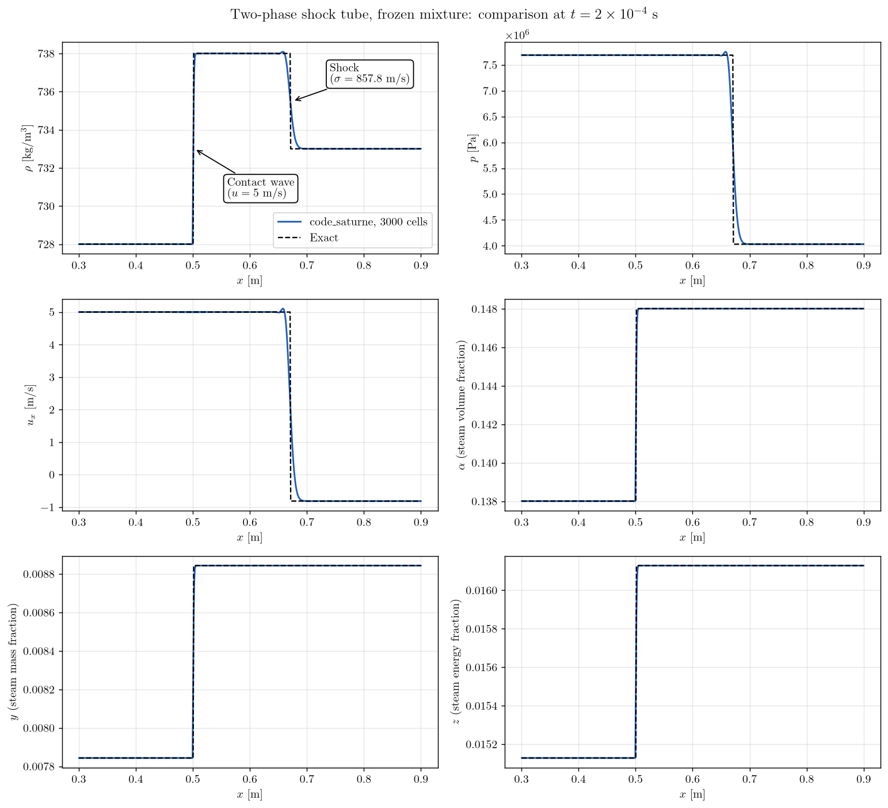
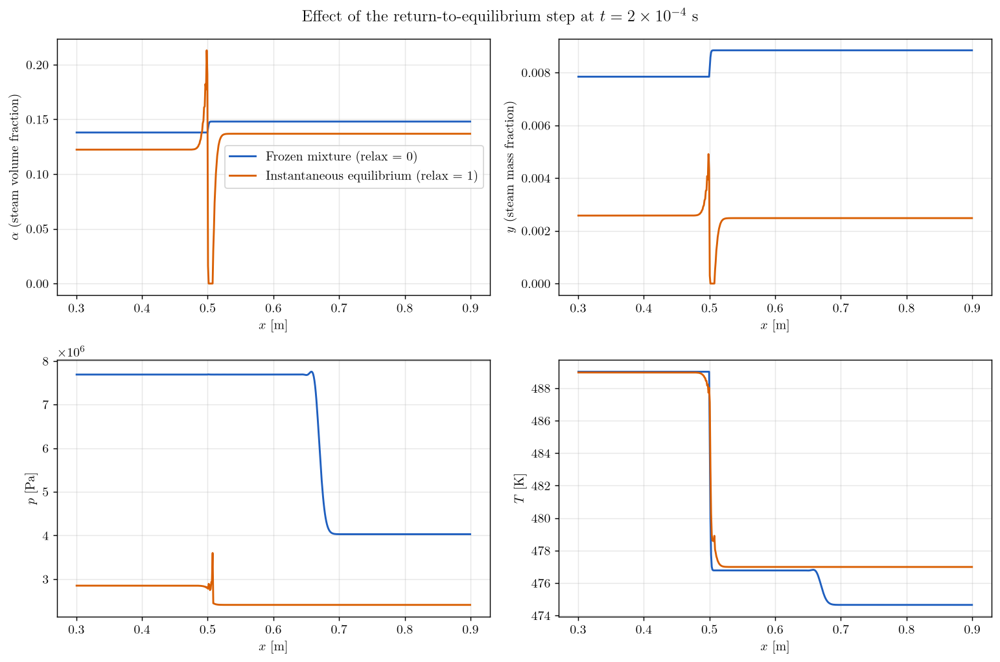

# Two-Phase Shock Tube (Compressible Homogeneous Model)

A step-by-step tutorial for the **compressible homogeneous two-phase model** of **code_saturne**: a steam-water mixture described by one velocity, one pressure and three transported fractions (volume, mass and energy fraction of the steam), each phase following a **stiffened gas** law. The case is the two-phase **Riemann problem** of Helluy, Hurisse and Le Coupanec (2016), whose exact solution has three constant states. A second run switches on the **return to thermodynamic equilibrium** (instantaneous condensation and vaporization) and checks that the mixture locks onto the saturation curve.

This model is distinct from the **VOF "homogeneous model"** of the GUI (series [50_vof](../../50_vof)), which is incompressible. Here the mixture is fully compressible and the thermodynamics of both phases is resolved.

Maintained by [Simvia](https://Simvia.tech/fr), part of the
[tutoriel-code_saturne](https://github.com/simvia-tech/tutorials-code_saturne) collection.

## Learning objectives

After completing this tutorial you will be able to:

1. Activate the **two-phase variant of the compressible module** and define a **stiffened gas** for each phase from `cs_user_parameters.cpp` (the model has no GUI panel).
2. Initialize a two-phase state from **density, total energy and the three fractions**, the only initialization path of this equation of state.
3. Validate a **frozen two-phase mixture** (no mass transfer) against the exact solution of a Riemann problem: contact wave, shock wave and intermediate state.
4. Apply the **return-to-equilibrium step** of the model from a user routine, switch it from the command line with a notebook variable, and verify that the two-phase cells satisfy $T = T_{sat}(p)$.
5. Know the **limitations of the model in v9.1** (closed domains only, no GUI, relaxation step to be called by the user) and the traps of its thermodynamics.

## Prerequisites

| Requirement | Detail |
|---|---|
| code_saturne | **v9.1** |
| Case | [Comp_Sod_Tube](../Comp_Sod_Tube) (compressible module, cartesian mesh, fixed time step) |
| Background | Gas dynamics; notions of two-phase thermodynamics (saturation, chemical potential) |

If code_saturne is not yet installed, build it from the
[official homepage](https://code-saturne.org/), pull a
ready-to-use Singularity image from the
[Open Simulation Center](https://open-simulation-center.org/downloads/code_saturne/code_saturne),
or pull the
[Simvia Docker image](https://hub.docker.com/r/Simvia/code_saturne) before continuing.

## Case files

```
Comp_Two_Phase_Shock_Tube/
├── CASE/
│   ├── DATA/
│   │   └── setup.xml                      # mesh, time stepping, notebook, 1D profile output
│   └── SRC/
│       ├── cs_user_parameters.cpp         # model activation, EOS, stiffened gas parameters
│       ├── cs_user_initialization.cpp     # left and right states of the Riemann problem
│       └── cs_user_extra_operations.cpp   # return-to-equilibrium step (notebook switch)
├── FIGURES/                               # figures used in this README
└── README.md
```

> There is **no MESH directory**: the mesh is generated at run time by the cartesian mesher configured in `setup.xml`. The three user routines are **mandatory**: the model cannot be set up from the GUI alone.

## Physical model

### Governing equations

The mixture has a single velocity $u$, density $\rho$ and total energy $E = e + u^2/2$, and obeys the Euler equations. Three additional fractions describe the steam (phase 1) inside the mixture: the volume fraction $\alpha$, the mass fraction $y$ and the energy fraction $z$. They are transported by the flow and relax towards their equilibrium values:

$$
\partial_t (\rho \phi) + \partial_x (\rho \phi u) = \rho\,\frac{\phi_{eq} - \phi}{\tau},
\qquad \phi \in \{\alpha, y, z\}.
$$

The phasic specific volumes and internal energies follow from the fractions, $\tau_1 = \alpha \tau / y$, $e_1 = z e / y$, $\tau_2 = (1-\alpha)\tau/(1-y)$, $e_2 = (1-z)e/(1-y)$ with $\tau = 1/\rho$, and the mixture pressure and temperature are built from the phasic laws $p_k(\tau_k, e_k)$ and $T_k(\tau_k, e_k)$:

$$
\frac{1}{T} = \frac{z}{T_1} + \frac{1-z}{T_2},
\qquad
\frac{p}{T} = \frac{\alpha\, p_1}{T_1} + \frac{(1-\alpha)\, p_2}{T_2}.
$$

The equilibrium fractions $(\alpha_{eq}, y_{eq}, z_{eq})$ are those for which the two phases have the same pressure, temperature and chemical potential at the given $(e, \tau)$. The relaxation time $\tau$ is a closure parameter:

- $\tau \to \infty$ (or step disabled): **frozen mixture**, the fractions are passive tracers, no mass transfer (run 1);
- $\tau \to 0$: **instantaneous equilibrium**, the mixture is always at saturation, this is the default of the code, $\tau = 10^{-30}$ s (run 2);
- finite $\tau$: metastable states (superheated liquid, subcooled steam), provided by the user routine `cs_user_hgn_thermo_relax_time` (not used here).

The model is solved by a fractional step algorithm: convection of all variables by the pressure-based compressible algorithm of code_saturne, then, at constant $\rho$, $u$ and $E$, exact integration of the relaxation ODE on each cell, $\phi^{n+1} = e^{-\Delta t/\tau}\phi^n + (1 - e^{-\Delta t/\tau})\phi_{eq}$, followed by an update of $p$ and $T$.

### Equations of state

Each phase is a **stiffened gas**: $p_k = (\gamma_k - 1)\, e_k/\tau_k - \gamma_k \Pi_k$ and $T_k = (e_k - \Pi_k \tau_k)/c_{v,k}$. The parameters are those of the reference, fitted on steam-water properties around 81 bar.

| Phase | Index in the code | $c_v$ [J/kg/K] | $\gamma$ | $\Pi$ [Pa] | $q'$ [J/kg/K] | $q$ [J/kg] |
|---|---|---|---|---|---|---|
| Steam | 0 (fractions transported) | $4477.815802223535$ | $1.084875362318841$ | $0$ | $-49292.11$ | $0$ |
| Liquid water | 1 | $1395.286166711847$ | $1.665128030303030$ | $3.725876146842836 \times 10^{8}$ | $0$ | $0$ |

The entropy constant $q'$ does not affect the frozen dynamics but fixes the saturation curve. The reference states $T_{sat}(81\ \mathrm{bar}) = 569$ K; the steam value of $q'$ is set so that the model reproduces it. The reference energy $q$ must be kept to zero in v9.1 (it is not yet taken into account in the equilibrium functions, see the source comment in `cs_cf_thermo.h`).

> **Trap.** The computation of the mixture sound speed starts from the saturation point at a hard-coded critical pressure ($1.5665 \times 10^{8}$ Pa). The thermodynamic parameters must admit a saturation point there, otherwise the run stops at the first time step with `specific energy <= 0`. The $q'$ value above satisfies this constraint; values taken from other stiffened gas fits of water do not.

### The Riemann problem

The domain is a closed tube with an initial discontinuity at $x_d = 0.5$ m. The fractions are those of the **steam**.

| State | $\alpha$ | $y$ | $z$ | $\rho$ [kg/m³] | $u$ [m/s] | $p$ [Pa] |
|---|---|---|---|---|---|---|
| Left ($x < 0.5$) | $0.138006860749359$ | $7.84348344805274 \times 10^{-3}$ | $1.51281566759212 \times 10^{-2}$ | $728$ | $5$ | $7.69 \times 10^{6}$ |
| Intermediate | $0.148006860749359$ | $8.84348344805274 \times 10^{-3}$ | $1.61281566759212 \times 10^{-2}$ | $738$ | $5$ | $7.69 \times 10^{6}$ |
| Right ($x \geq 0.5$) | $0.148006860749359$ | $8.84348344805274 \times 10^{-3}$ | $1.61281566759212 \times 10^{-2}$ | $733$ | $-0.817013411825561$ | $4.02907811372493 \times 10^{6}$ |

Without mass transfer, the exact solution consists of the left state, a **contact wave** moving at $u = 5$ m/s (across which only $\rho$ and the fractions jump) and a **shock wave** moving at $\sigma = 857.774166173626$ m/s; the $u - c$ wave has zero amplitude. At $t = 2 \times 10^{-4}$ s the contact is at $x = 0.501$ m and the shock at $x = 0.6716$ m.

> **Sign of the right velocity.** Table 1 of the reference prints $u_R = +0.817$ m/s. The Rankine-Hugoniot relations across the shock, written with the quoted shock speed and the intermediate and right states, are only satisfied for $u_R = -0.817$ m/s (mass flux $629347$ kg/m²/s on both sides). With the printed sign a spurious $u - c$ wave of finite amplitude appears. The negative value is used here.

### Flow parameters

| Quantity | Symbol | Value | Source |
|---|---|---|---|
| Model activation | `CS_COMPRESSIBLE` flag | $2$ | `cs_user_model` in `cs_user_parameters.cpp` |
| Equation of state | `ieos` | `CS_EOS_HOMOGENEOUS_TWO_PHASE` | `cs_user_parameters.cpp` |
| Stiffened gases | see table above | `cs_hgn_thermo_define_stiffened_gas` | `cs_user_parameters.cpp` |
| Imposed variables at $t=0$ | `ithvar` | $210000$ ($\rho$ and $E$) | `cs_user_initialization.cpp` |
| Mixture sound speed | $c$ | $867$ m/s (left), $854$ m/s (right) | computed by the code |
| Domain | $x \in [-1, 2]$ m | $3000$ uniform cells ($\Delta x = 1$ mm) | `mesh_cartesian` |
| Time step | $\Delta t$ | $2.5 \times 10^{-7}$ s (fixed) | `time_step_ref` |
| Final time | $t_{end}$ | $2 \times 10^{-4}$ s ($800$ iterations) | `iterations` |
| Relaxation switch | `relax` | $0$ (frozen) or $1$ (equilibrium) | notebook variable |

The fixed time step corresponds to an acoustic CFL $(|u|+c)\,\Delta t/\Delta x \approx 0.22$.

## Geometry and boundary conditions

The domain is a thin box of $3 \times 0.01 \times 1$ m meshed with $3000 \times 1 \times 1$ cells: a 1D problem computed on a 3D mesh. All six boundaries are **symmetry planes**. The reference uses inlet and outlet conditions filled with the exact solution, but **in v9.1 the two-phase model only supports closed domains**: the inlet and outlet conditions of the compressible module do not set the fractions on the boundary (the code aborts on an assertion). The tube is therefore made long enough, $[-1, 2]$ m instead of $[0, 1]$ m, for the waves reflected by the ends (at most $0.17$ m deep at $t_{end}$) to stay away from the solution of interest.

| Boundary | Nature | Zone / selection |
|---|---|---|
| all six faces | Symmetry | `X0`, `X1`, `Y0`, `Y1`, `Z0`, `Z1` |

The initial states are set cell by cell in `cs_user_initialization.cpp`: the mixture internal energy is obtained from $(\alpha, y, z, p, \rho)$ by inverting the pressure law with `cs_hgn_thermo_ie`, the total energy adds $u^2/2$, and the indicator `ithvar = 210000` tells the module that density and total energy are the imposed variables. The GUI initialization by pressure and temperature does not go through the two-phase thermodynamics and cannot be used.

## Numerical setup

| Setting | Value | Rationale |
|---|---|---|
| Compressible algorithm | pressure-based, two-phase EOS | `ieos = 4`, flag `CS_COMPRESSIBLE = 2` |
| Convection schemes | 1st-order upwind (all variables) | imposed by the compressible module |
| Fractions | pure convection equations, no diffusion | created by the module (`volume_fraction`, `mass_fraction`, `energy_fraction`) |
| Time-stepping | **Fixed time step**, $2.5 \times 10^{-7}$ s | time-accurate transient, CFL $\approx 0.22$ |
| Return to equilibrium | `hgn_relax_eq_st = 0` (enabled), applied from `cs_user_extra_operations` when `relax = 1` | see note below |
| Viscosities, conductivity | $0$ (user laws) | Euler limit |
| Pressure at walls | hydrostatic form (`icfgrp = 1`, default) with zero gravity | homogeneous Neumann; the wall Riemann solver of the module is not written for this EOS |
| 1D output | `profiles` block, 3000 points along the axis, CSV at the end | `RESU/<id>/profiles/tube.csv` |

> **Why the relaxation step sits in a user routine.** In v9.1 the solver calls `cs_hgn_source_terms_step` only when the compressible flag equals $1$, whereas the fractions are created for the value $2$: the step is never applied by the solver itself. `cs_user_extra_operations.cpp` calls it at the end of each time step, which is exactly the fractional step of the model (relaxation after convection, at constant $\rho$, $u$, $E$). The notebook variable `relax` switches it on.

## Running the simulation

The commands below start from the tutorial directory:

```bash
cd Comp_Two_Phase_Shock_Tube/
```

### Option A: Graphical interface

```bash
code_saturne gui CASE/DATA/setup.xml &
```

The GUI shows the mesh (**Mesh > Cartesian mesh**), the time stepping, the notebook variable `relax` (**Physical properties > Notebook**) and the 1D profile. The two-phase model itself does not appear in the GUI: it is entirely defined in `CASE/SRC`. Launch the run with the **gear (Run) button**.

### Option B: Command line

```bash
cd CASE

# run 1: frozen mixture (relax = 0, default of the notebook)
code_saturne run --id frozen

# run 2: instantaneous return to equilibrium
code_saturne run --notebook-args relax=1 --id equilibrium
```

Each run creates `CASE/RESU/<id>/` containing:

- `run_solver.log`: solver log and residual history,
- `profiles/tube.csv`: the 1D profile at $t_{end}$ ($x$, fractions, density, velocity, pressure, temperature, total energy),
- `postprocessing/`: volume and boundary fields in EnSight Gold format (final time).

Each run takes about ten seconds in serial.

## Results and verification

### Run 1: frozen mixture against the exact solution

<p align="center">
  
  <br>
  <em>Figure 1: Density, pressure, velocity and steam fractions at $t = 2 \times 10^{-4}$ s, code_saturne with 3000 cells (solid) against the exact solution (dashed). The contact wave carries the jump of density and fractions, the shock carries the jump of pressure and velocity.</em>
</p>

The three constant states and the two waves are reproduced:

- The **contact wave** is captured at $x = 0.5005$ m (exact $0.501$ m), within one cell, and the fractions jump over about five cells.
- The **shock** is captured at $x = 0.6706$ m (exact $0.6716$ m) and spread over about $0.02$ m, with a small overshoot of density, pressure and velocity ahead of it, a known behavior of the pressure-based algorithm with the first-order scheme (see the Sod tube).
- No wave of finite amplitude appears at $x = 0.5 - c\,t \approx 0.33$ m: the $u - c$ wave is indeed a ghost wave.

$L^1$ relative errors over $0 < x < 1$ m:

| $\alpha$ | $y$ | $z$ | $\rho$ | $u$ | $p$ |
|---|---|---|---|---|---|
| $5.2 \times 10^{-5}$ | $8.9 \times 10^{-5}$ | $5.0 \times 10^{-5}$ | $4.3 \times 10^{-5}$ | $7.9 \times 10^{-3}$ | $2.8 \times 10^{-3}$ |

The errors on $u$ and $p$ are those of the smeared shock; the errors on the fractions and the density are those of the smeared contact.

### Run 2: instantaneous return to equilibrium

<p align="center">
  
  <br>
  <em>Figure 2: Steam volume fraction, steam mass fraction, pressure and temperature at $t = 2 \times 10^{-4}$ s, frozen mixture (blue) against instantaneous return to equilibrium (orange).</em>
</p>

The initial states are subcooled: at $7.69$ MPa the saturation temperature of the model is $565$ K whereas the mixture is at $489$ K. With the relaxation step enabled, the steam condenses from the first time step on and the whole tube drops to the saturation curve:

| Zone | $p$ [MPa] | $T$ [K] | $T_{sat}(p)$ [K] | $y$ | $\alpha$ |
|---|---|---|---|---|---|
| Left plateau, frozen | $7.69$ | $489.0$ | $564.8$ | $7.84 \times 10^{-3}$ | $0.138$ |
| Left plateau, equilibrium | $2.849$ | $488.97$ | $488.97$ | $2.58 \times 10^{-3}$ | $0.122$ |
| Right plateau, frozen | $4.03$ | $474.7$ | $514.5$ | $8.84 \times 10^{-3}$ | $0.148$ |
| Right plateau, equilibrium | $2.408$ | $476.99$ | $476.99$ | $2.48 \times 10^{-3}$ | $0.137$ |

On the two-phase cells of the equilibrium run, $|T - T_{sat}(p)|$ stays below $10^{-3}$ K, where $T_{sat}(p)$ is computed from the equality of the chemical potentials of the two stiffened gases: the relaxation step does bring the mixture onto the saturation curve. The temperature barely changes (the condensed mass is small and the density is fixed during the step) while the pressure drops by a factor of two to three, which is the signature of the latent heat exchange at constant internal energy.

Two features of this run deserve a comment:

- The pressure and velocity waves have only travelled about $1.3$ cm from the initial discontinuity, against $17$ cm for the frozen mixture: the effective sound speed of the equilibrium mixture is of the order of $65$ m/s, far below the frozen value of $860$ m/s. This drop of the sound speed at equilibrium is a classical property of homogeneous equilibrium models.
- At the initial discontinuity, where the numerical scheme mixes the two states, a pocket of about seven cells ends up as pure liquid ($\alpha = 0$) surrounded by a spike of steam. For those mixed cells the equilibrium search does not find a two-phase root and falls back to the single-phase state of highest entropy. This is a limitation of the equilibrium algorithm on strongly mixed cells, not a physical feature.

Mass and total energy are conserved by both runs: the integrated mass over the tube is $2191.5000$ kg/m² for both runs and for the initial state, and the integrated total energy differs from its initial value by $1 \times 10^{-6}$ in relative terms.

### Frozen mixture versus instantaneous equilibrium, in practice

The only difference between the two runs is the notebook variable `relax`, read in `cs_user_extra_operations.cpp`. No relaxation time is set anywhere in the case:

- with `relax = 0` the return-to-equilibrium step is never called. The fractions are transported by the convection step and nothing else modifies them. This is strictly equivalent to $\tau = +\infty$;
- with `relax = 1` the step is called at the end of every time step. Since the routine `cs_user_hgn_thermo_relax_time` is not provided, $\tau$ keeps its default value of $10^{-30}$ s, the factor $e^{-\Delta t/\tau}$ is exactly zero in floating-point arithmetic and each fraction is replaced by its equilibrium value. This is equivalent to $\tau = 0$.

A finite relaxation time sits between the two: adding the routine with, for instance, $\tau = 10^{-4}$ s gives $e^{-\Delta t/\tau} \approx 0.9975$ per time step, hence a progressive condensation over a few tenths of a millisecond instead of a jump at the first time step.

What the step does on a cell is worth spelling out. At fixed $\rho$, $u$ and $E$, hence at fixed $e$ and $\tau = 1/\rho$, the code looks for the point $(p, T)$ of the saturation curve of the model and the fractions $(\alpha_{eq}, y_{eq}, z_{eq})$ that give exactly this energy and this volume with both phases at the same pressure, temperature and chemical potential. It then overwrites the fractions and recomputes $p$ and $T$. Energy and mass are untouched, which is why both are conserved.

This explains the collapse of the pressure in run 2. The initial states are subcooled for the thermodynamics of the model: at $7.69$ MPa the saturation temperature is $565$ K while the mixture is at $489$ K, so the steam must condense. The liquid dominates the heat capacity, so the temperature can hardly move: equilibrium is reached by moving the pressure until $T_{sat}(p) = T$, that is to about $2.85$ MPa. Mechanically, condensing a little steam frees volume, the nearly incompressible liquid expands by about $1\%$, and with a stiffened gas law at $\Pi = 3.7 \times 10^{8}$ Pa this small expansion lowers its pressure by several MPa. At equilibrium the pressure is no longer an independent variable: it is the saturation pressure of the temperature set by the energy content.

It also explains why the waves are so slow in run 2. At every time step the pressure is brought back onto the saturation curve. A compression no longer raises the pressure as in the frozen mixture: it condenses steam at nearly constant pressure. The apparent stiffness of the mixture, hence its effective sound speed, is much lower. This is the equilibrium sound speed, of the order of a few tens of m/s for this void fraction, against $860$ m/s at frozen composition. Note that the convection step always uses the frozen sound speed for the fluxes: the slow waves of run 2 emerge from the splitting between convection and relaxation, they are not imposed by the scheme, which is the expected behavior of the fractional step method of the model.

## Summary

This tutorial set up the compressible homogeneous two-phase model of code_saturne entirely from user routines: model flag and two-phase equation of state, one stiffened gas per phase, initialization by density, total energy and fractions. Without mass transfer the computed two-phase Riemann problem matches the exact three-state solution. With the return-to-equilibrium step, applied from a user routine, the two-phase cells lock onto the saturation curve of the model, while mass and energy remain conserved. The model in v9.1 is restricted to closed domains, has no GUI support, and requires thermodynamic parameters compatible with a hard-coded critical pressure: the README documents each of these points so that the case can be adapted to other mixtures.

## References

- P. Helluy, O. Hurisse, E. Le Coupanec. Verification of a two-phase flow code based on an homogeneous model, [International Journal on Finite Volumes, 13, 2016](https://hal.science/hal-01396200).
- O. Hurisse. Application of an homogeneous model to simulate the heating of two-phase flows, [International Journal on Finite Volumes, 11, 2014](https://hal.science/hal-01114808).
- [code_saturne documentation](https://code-saturne.org/doc/)

## Authors

[Simvia](https://Simvia.tech/fr) - Questions, remarks and requests are welcome.
