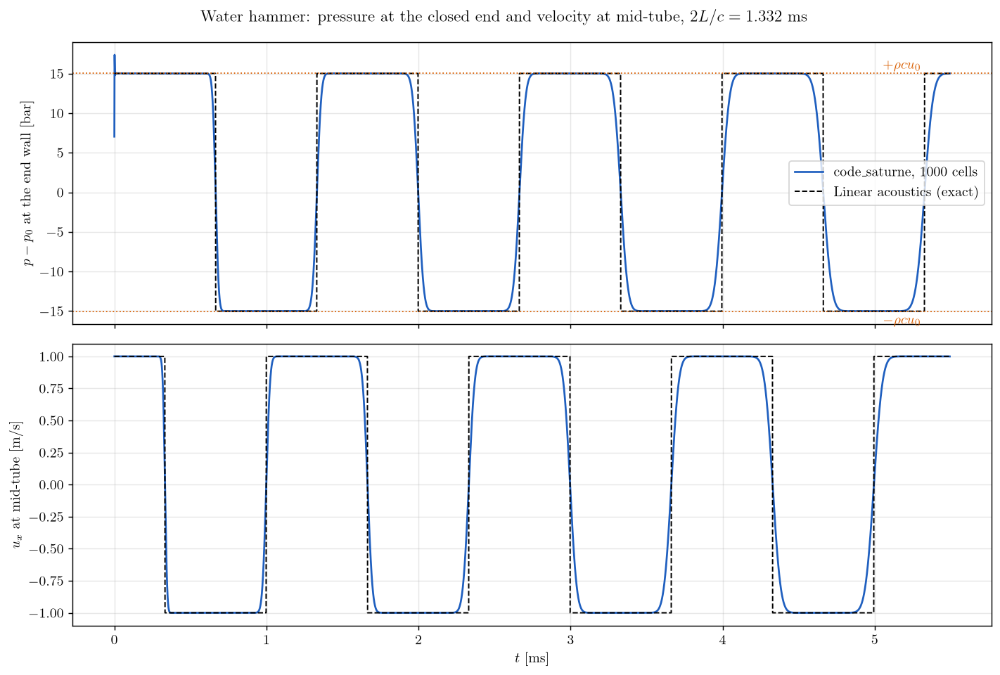
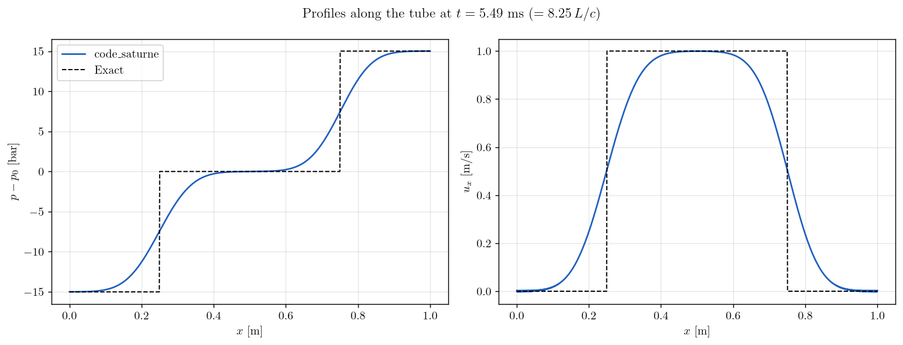

# Water Hammer in a Closed Pipe (Stiffened Gas)

A tutorial on the **stiffened gas** equation of state of the **compressible module** of **code_saturne**, which makes it a solver for **pressure waves in liquids**: a column of water moving at 1 m/s in a closed pipe is stopped by the end walls, and the pressure surge travels back and forth between them. The pressure history at the wall is validated against the **Joukowsky formula** $\Delta p = \rho c u_0$ and the **period** $2L/c$ of the linear acoustic solution.

Maintained by [Simvia](https://Simvia.tech/fr), part of the
[tutoriel-code_saturne](https://github.com/simvia-tech/tutorials-code_saturne) collection.

## Learning objectives

After completing this tutorial you will be able to:

1. Select the **stiffened gas** law of the compressible module and fit its constants to a liquid (density and sound speed at a reference state).
2. Set the **specific heats** the law needs, which the GUI cannot provide for this equation of state.
3. Initialize a compressible case fully from the GUI with **notebook variables** (pressure, temperature, velocity).
4. Validate a water hammer against the **Joukowsky formula** and the acoustic period, and read the numerical diffusion of the fronts after several reflections.

## Prerequisites

| Requirement | Detail |
|---|---|
| code_saturne | **v9.1** |
| Case | [Comp_Sod_Tube](../Comp_Sod_Tube) (compressible module, cartesian mesh, fixed time step) |
| Background | Linear acoustics, method of characteristics |

If code_saturne is not yet installed, build it from the
[official homepage](https://code-saturne.org/), pull a
ready-to-use Singularity image from the
[Open Simulation Center](https://open-simulation-center.org/downloads/code_saturne/code_saturne),
or pull the
[Simvia Docker image](https://hub.docker.com/r/Simvia/code_saturne) before continuing.

## Case files

```
Comp_Water_Hammer/
├── CASE/
│   ├── DATA/
│   │   └── setup.xml                      # mesh, walls, initial state, notebook, probes, 1D profile
│   └── SRC/
│       └── cs_user_parameters.cpp         # stiffened gas law and its constants
├── FIGURES/
└── README.md
```

> No MESH directory: the mesh is generated at run time by the cartesian mesher. The single user routine selects the equation of state, which the GUI does not offer; everything else is defined in `setup.xml`.

## Physical model

The water obeys the Euler equations with the **stiffened gas** law

$$
p = (\gamma - 1)\,\rho\, e - \gamma\, \Pi,
\qquad
T = \frac{e - \Pi/\rho}{c_v},
\qquad
c = \sqrt{\frac{\gamma\,(p + \Pi)}{\rho}},
$$

an ideal gas shifted by the pressure $\Pi$, which makes the fluid nearly incompressible: with $\Pi \gg p$ the sound speed hardly depends on the pressure. The three constants are fitted so that water at $p_0 = 1$ bar and $T_0 = 300$ K has $\rho_0 = 1000$ kg/m³ and $c = 1500$ m/s with $c_v = 4180$ J/kg/K:

| Constant | Relation | Value |
|---|---|---|
| $\gamma$ | $\gamma(\gamma - 1) = c^2/(c_v T_0)$ | $1.9311$ |
| $\Pi$ | $\rho_0 (\gamma - 1) c_v T_0 - p_0$ | $1.16753 \times 10^{9}$ Pa |
| $c_p$ | $\gamma c_v$ | $8072$ J/kg/K |

The resulting sound speed is $c = 1501.6$ m/s. These constants reproduce the density and the compressibility of water at the reference state only; they are not meant for large temperature excursions.

### The water hammer

A pipe of length $L = 1$ m closed at both ends contains water at $p_0$ and $T_0$ moving at $u_0 = 1$ m/s. At $t = 0$ the fluid is stopped by the right wall and pulled away from the left wall: a compression wave $+\rho c u_0$ leaves the right wall and a rarefaction $-\rho c u_0$ leaves the left wall, both at speed $c$. They cross at mid-tube at $t = L/(2c)$, reverse the velocity to $-u_0$, reflect on the opposite walls, and so on. For $u_0 \ll c$ the linear acoustic solution is exact: at the right wall the pressure is a **square wave** of amplitude $\pm \rho c u_0 = \pm 15.0$ bar and period $2L/c = 1.332$ ms; at mid-tube the pressure stays at $p_0$ and the velocity alternates between $+u_0$ and $-u_0$ every $L/c$.

## Geometry and boundary conditions

Thin box of $1 \times 0.01 \times 1$ m meshed with $1000 \times 1 \times 1$ cells ($\Delta x = 1$ mm). The two ends are **walls**, the four lateral faces **symmetry planes**. The initial state is set from the GUI on the whole domain with the notebook variables `p0`, `t0` and `u0` (pressure, temperature and velocity formulas): pressure and temperature are the two imposed thermodynamic variables, the density and energy follow from the stiffened gas law.

| Boundary | Nature | Zone / selection |
|---|---|---|
| `x0`, `x1` | Wall | `X0`, `X1` |
| `y0`, `y1`, `z0`, `z1` | Symmetry | `Y0`, `Y1`, `Z0`, `Z1` |

With the default pressure treatment of the compressible module at walls (`icfgrp = 1`, homogeneous Neumann), symmetry planes at the ends give exactly the same result.

## Numerical setup

| Setting | Value |
|---|---|
| Equation of state | `ieos = CS_EOS_STIFFENED_GAS`, `gammasg`, `psginf`, `cv0`, `cp0` set in `cs_user_parameters.cpp` |
| Convection schemes | 1st-order upwind (imposed by the compressible module) |
| Time step | fixed, $4 \times 10^{-7}$ s, $13735$ iterations, $t_{end} = 5.494$ ms $= 8.25\,L/c$, CFL $= 0.6$ |
| Viscosity, conductivity | water values, $10^{-3}$ Pa.s and $0.6$ W/m/K, constant |
| Probes | $x = 0.9995$ m (end wall) and $x = 0.5005$ m, every time step |
| 1D output | `profiles` block, CSV at the end |

> **Two settings the GUI cannot make.** For the stiffened gas, $c_v$ is not deduced from $c_p$ and the molar mass as for an ideal gas: `cv0` must be set in `cs_user_parameters.cpp`, together with `cp0 = gamma * cv0`. And the viscosity must not be zero: the zero user laws used by the inviscid tutorials make the wall $y^+$ undefined, and the NaN check of the solver stops the run. The real viscosity of water has no visible effect on the waves.

## Running the simulation

```bash
cd Comp_Water_Hammer/CASE
code_saturne run
```

The run takes about $30$ s in serial and writes `run_solver.log`, `monitoring/probes_<variable>.csv` (time histories at the two probes), `profiles/tube.csv` (profile at $t_{end}$) and the EnSight output. The initial velocity can be changed from the command line, for instance `code_saturne run --notebook-args u0=2`.

## Results and verification

<p align="center">
  
  <br>
  <em>Figure 1: Pressure at the end wall (top) and velocity at mid-tube (bottom), code_saturne (solid) against the linear acoustic solution (dashed). The dotted lines are the Joukowsky levels $\pm \rho c u_0$.</em>
</p>

- The first pressure plateau at the wall is $15.02$ bar above $p_0$, the Joukowsky value $\rho c u_0 = 15.016$ bar to $0.05\%$. After seven reflections the plateau is still within $0.5\%$ of it.
- The velocity at mid-tube reverses at $t = 0.3336$ ms (exact $L/(2c) = 0.3330$ ms): the wave speed is recovered to $0.3\%$. The sign changes of the wall pressure are spaced by $0.666$ ms, exactly $L/c$.
- The first time step shows a spike of $16\%$ above the plateau at the wall, where the moving fluid is stopped in one step; it lasts a few microseconds and does not propagate.
- The fronts widen with each reflection: the 10-90% fall time at the wall grows from $42$ µs after the first reflection to $113$ µs after the seventh, the numerical diffusion of the first-order scheme on a discontinuity that is never steepened.

<p align="center">
  
  <br>
  <em>Figure 2: Pressure and velocity along the tube at $t_{end} = 8.25\,L/c$, code_saturne (solid) against the exact solution (dashed).</em>
</p>

At $t_{end}$ the two fronts sit at $x = 0.25$ and $0.75$ m: the plateaus ($-15$, $0$ and $+15$ bar; $0$, $u_0$ and $0$) are exact, and each front, which has been reflected eight times, is spread over about $0.18$ m (10 to 90 %). The temperature varies by $\pm 0.19$ K only: the compression of a liquid is almost isothermal, as the stiffened gas law with a large $\Pi$ implies.

## Summary

With the stiffened gas law and three constants fitted to the density and the sound speed of water, the compressible module computes a water hammer whose surge amplitude and period match the Joukowsky formula and the acoustic solution to a fraction of a percent. The case needs one user routine, because the GUI does not expose this equation of state nor the specific heats it requires, and a non-zero viscosity at the walls. The first-order upwind scheme preserves the plateaus but smears the fronts a little more at each reflection.

## References

- M.H. Chaudhry. Applied Hydraulic Transients, 3rd edition, Springer, 2014 (chapter 2, Joukowsky formula and the water hammer diagram).
- E.F. Toro. Riemann Solvers and Numerical Methods for Fluid Dynamics, 3rd edition, Springer, 2009 (chapter 1, stiffened gas law).
- [code_saturne documentation](https://code-saturne.org/doc/)

## Authors

[Simvia](https://Simvia.tech/fr) - Questions, remarks and requests are welcome.
