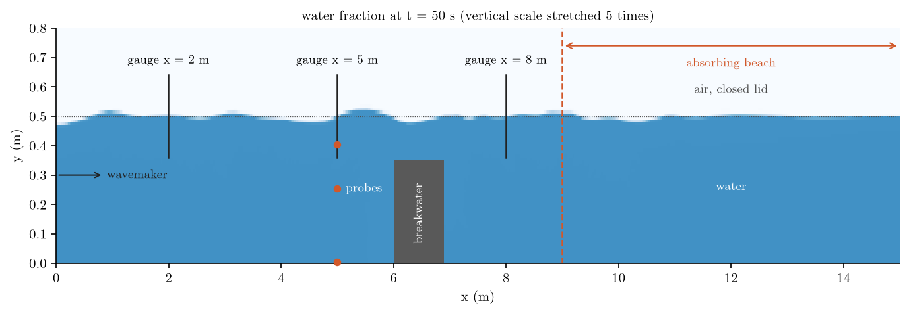
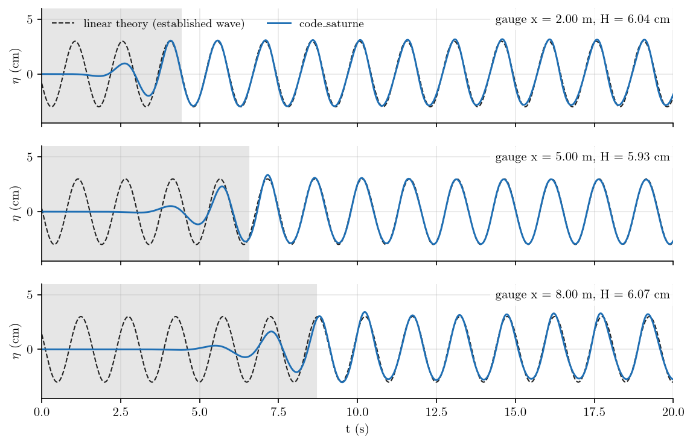
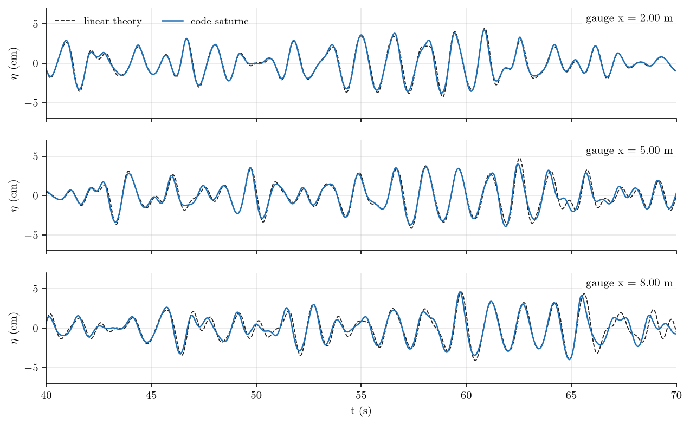
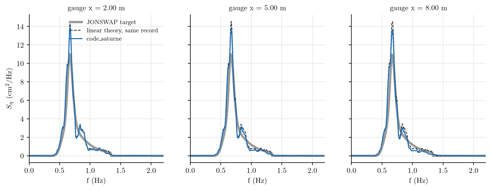
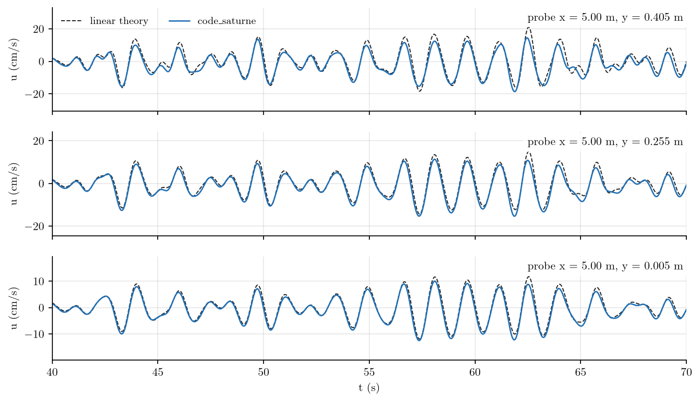
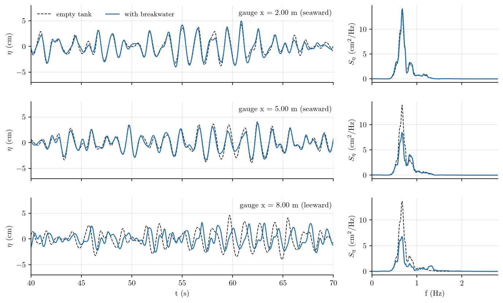
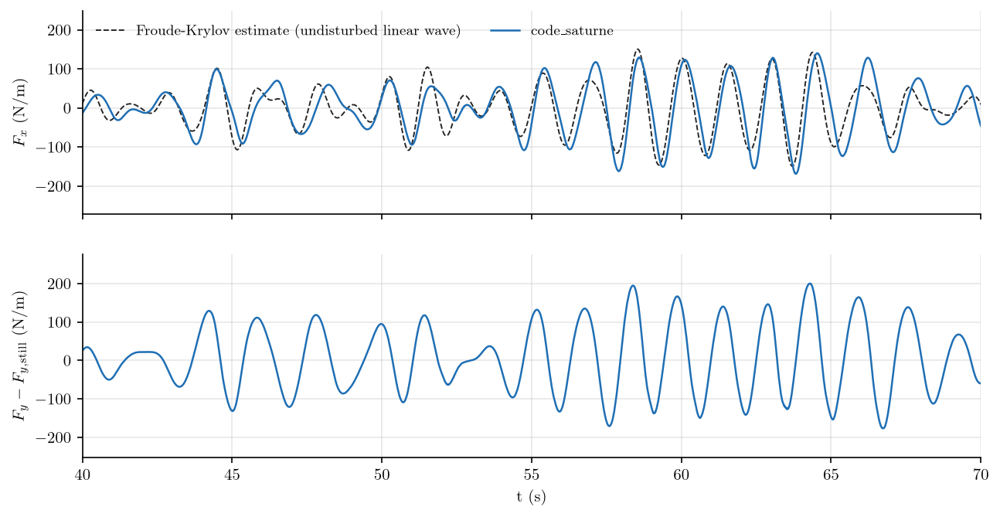

# Irregular Waves in a Numerical Wave Tank (VOF)

A step-by-step tutorial that turns the VOF model of **code_saturne** into a **numerical wave tank**: a wavemaker generates an irregular sea state with a JONSWAP spectrum, the waves travel along a flume and die in an absorbing beach, and wave gauges record the free surface exactly as in a laboratory. The tutorial follows the practice of a wave flume. The incident sea state is first calibrated in the **empty tank**, where it is checked against linear wave theory, wave by wave and in the frequency domain. A **submerged breakwater** is then placed in the tank, in the same sea state, to read what a designer is after: the waves transmitted behind the structure and the wave loads on it.

Maintained by [Simvia](https://Simvia.tech/fr), part of the
[tutoriel-code_saturne](https://github.com/simvia-tech/tutorials-code_saturne) collection.

## Learning objectives

After completing this tutorial you will be able to:

1. Keep a water surface **at rest** under gravity with the VOF model, by choosing the reference density of the hydrostatic pressure.
2. Build a **wavemaker** from a time-dependent inlet (velocity and void fraction), and make it conservative so that the tank needs no open boundary.
3. Absorb the waves with a **momentum sink** (numerical beach) and measure the free surface with **wave gauges**.
4. Verify an irregular sea state against linear theory: surface elevation, orbital velocity and **wave spectrum**.
5. Carve a **structure** out of the cartesian mesh and extract the transmitted waves and the **wave loads**.

## Prerequisites

| Requirement | Detail |
|---|---|
| code_saturne | **v9.1** |
| Tutorial | [Vof_Dam_Break](../Vof_Dam_Break) (the VOF model and its water-air setup) |

If code_saturne is not yet installed, build it from the
[official homepage](https://code-saturne.org/), pull a
ready-to-use Singularity image from the
[Open Simulation Center](https://open-simulation-center.org/downloads/code_saturne/code_saturne),
or pull the
[Simvia Docker image](https://hub.docker.com/r/Simvia/code_saturne) before continuing.

## Case files

```
Vof_Irregular_Waves/
├── CASE/
│   ├── DATA/setup.xml                     # VOF water-air, mesh, sea state and switches (notebook), probes
│   └── SRC/
│       ├── wave_tank.h                    # sea state: JONSWAP components, tank and breakwater layout
│       ├── cs_user_mesh.cpp               # the breakwater, carved out of the mesh
│       ├── cs_user_parameters.cpp         # reference density of the hydrostatic pressure
│       ├── cs_user_boundary_conditions.cpp # the wavemaker
│       ├── cs_user_source_terms.cpp       # the absorbing beach
│       └── cs_user_extra_operations.cpp   # the wave gauges and the loads on the breakwater
├── FIGURES/                               # figures used in this README
└── README.md
```

> Built-in cartesian mesher, no mesh file. The sea state ($H_s$, $T_p$, $\gamma$, water depth) and two switches (`regular`, `structure`) are set in the **notebook** of the GUI; the user routines read them from there.

## Physical model

### The sea state

A real sea is not a regular wave train: it is a superposition of many waves of different periods, described by a **spectrum** $S(f)$ that tells how the wave energy is spread over the frequencies. The JONSWAP spectrum, the standard of offshore and coastal design, is defined by a significant wave height $H_s$, a peak period $T_p = 1/f_p$ and a peak enhancement factor $\gamma$:

$$
S(f) \propto f^{-5} \exp\left[-\frac54\left(\frac{f_p}{f}\right)^4\right]
\gamma^{\exp\left[-\frac{(f-f_p)^2}{2\sigma^2 f_p^2}\right]},
\qquad \sigma = 0.07\ (f \le f_p),\ \ 0.09\ (f > f_p)
$$

normalized so that $H_s = 4\sqrt{m_0}$, with $m_0 = \int S\,df$ the variance of the surface elevation. The spectrum is cut into $N = 100$ bins of width $\Delta f$ over $[0.5 f_p,\ 2 f_p]$ and each bin becomes one linear (Airy) wave of amplitude $a_j = \sqrt{2 S(f_j)\Delta f}$ and random phase $\varphi_j$:

$$
\eta(x,t) = \sum_{j=1}^{N} a_j \cos(k_j x - \omega_j t + \varphi_j),
\qquad \omega_j^2 = g\,k_j \tanh(k_j h)
$$

The dispersion relation gives each component its own wavenumber, hence its own celerity: the long waves run ahead of the short ones and the shape of the wave train changes all along the tank. The phases are drawn with a fixed seed, so that the sea state is the same at every run. The signal repeats after $1/\Delta f = 100$ s, the duration of the simulation.

### Flow parameters

| Quantity | Value | Where |
|---|---|---|
| Still water depth $h$ | $0.5$ m | notebook `depth` |
| Significant wave height $H_s$ | $0.06$ m | notebook `Hs` |
| Peak period $T_p$ | $1.5$ s | notebook `Tp` |
| Peak enhancement factor $\gamma$ | $3.3$ | notebook `gamma` |
| Peak wavelength $\lambda_p$ | $2.83$ m ($k_p h = 1.11$, intermediate depth) | dispersion relation |
| Water | $\rho = 1000$ kg/m³, $\mu = 10^{-3}$ Pa.s | fluid properties |
| Air | $\rho = 1$ kg/m³, $\mu = 1.48 \times 10^{-5}$ Pa.s | fluid properties |
| Gravity | $g = 9.81$ m/s² along $-y$ | gravity |

These are the dimensions of a laboratory flume. With Froude similarity at scale 1:40 they stand for a sea state of $H_s = 2.4$ m and $T_p = 9.5$ s in $20$ m of water. The waves are moderately steep ($k_p H_s/2 = 0.067$) and do not break. The flow is laminar and surface tension is off: at these wavelengths gravity alone drives the waves.

## Geometry and boundary conditions

<p align="center">
  
  <br>
  <em>Figure 1: the tank, colored by the water fraction of the run with the breakwater. The wavemaker is the left boundary, the absorbing beach fills the last 6 m, and the tank is closed by a lid. Three gauges record the surface elevation, two seaward of the breakwater and one in its lee; three probes under the middle gauge record the velocity and the pressure.</em>
</p>

The tank is $15$ m long and $0.8$ m high ($0.5$ m of water under $0.3$ m of air), one cell thick ($0.02$ m). The working section runs from the wavemaker to $x = 9$ m (about three peak wavelengths), the beach from $9$ to $15$ m (about two).

| Boundary | Selection | Condition |
|---|---|---|
| `wavemaker` | $x = 0$ | inlet, velocity and void fraction from the user routine |
| `end_wall` | $x = 15$ m | symmetry (impermeable, slip) |
| `bottom` | $y = 0$ | symmetry (impermeable, slip) |
| `lid` | $y = 0.8$ m | symmetry (impermeable, slip) |
| `sides` | $z = 0$ and $0.02$ m | symmetry (two-dimensional flow) |
| `structure` | group `structure` (faces of the breakwater) | smooth wall; empty when the tank is empty |

In code_saturne a symmetry is an impermeable wall without friction. The slip is deliberate on the bottom: the oscillating boundary layer under the waves is $\sqrt{2\nu/\omega} \approx 0.7$ mm thick, far below the cell size, and plays no role in the propagation over a few wavelengths.

### The wavemaker

Below the instantaneous free surface $y = h + \eta(0,t)$, the wavemaker imposes the velocity of the linear components,

$$
u = \sum_j a_j\omega_j \frac{\cosh k_j y_s}{\sinh k_j h}\cos\theta_j,
\qquad
v = \sum_j a_j\omega_j \frac{\sinh k_j y_s}{\sinh k_j h}\sin\theta_j,
\qquad \theta_j = -\omega_j t + \varphi_j
$$

evaluated at the stretched height $y_s = y\,h/(h+\eta)$ (**Wheeler stretching**: the profile that linear theory defines between the bottom and the still water level is stretched up to the moving surface, which avoids the unphysical velocities of the short components in the crests). The void fraction of each boundary face is the fraction of its height above the surface. A cosine ramp brings the waves in over $2T_p$.

Two corrections make this wavemaker **conservative**, and they are what allows the lid to be closed:

- **Return current in the water.** Imposing the velocity up to the moving surface lets more water in under the crests than out under the troughs (the Stokes drift of the waves): the tank would slowly fill up. A uniform velocity is subtracted in the water so that the water flow rate equals its linear value $\sum_j a_j (\omega_j/k_j)\cos\theta_j$, whose time average is zero.
- **Counter-flow in the air.** The water flow rate oscillates: water is pushed in under a crest and drawn out under a trough. In a closed incompressible domain the net volume flow rate through the boundary must vanish at every instant, so the faces above the surface receive the uniform air velocity that carries the opposite flow rate. This is what happens through any cross-section of a covered flume: the air flows back above the water that moves forward. The air velocity stays below a few tens of cm/s and, the air being a thousand times lighter, the waves do not feel it.

With no open boundary left, nothing can blow in or out of the air region, which is the usual weak point of a two-phase wave tank.

### The breakwater

The structure is a rectangular block standing on the bottom between $x = 6$ and $6.9$ m, $0.35$ m high: its crest lies $0.15$ m below the still water level, $2.5\,H_s$. When the notebook switch `structure` is $1$, `cs_user_mesh.cpp` removes the cells of the block from the cartesian mesh and puts the boundary faces created around the hole in a group named `structure`, which the boundary zone of the same name selects. With `structure` at $0$ the mesh is left untouched, the zone has no face (the solver warns that the group does not exist, which is expected) and the tank is empty. The sides of the block must lie on cell faces, which is why its length is $0.9$ m and not $1$ m with $3$ cm cells.

### The absorbing beach

For $x > 9$ m the momentum equation receives the sink

$$
\mathbf{S} = -\rho\,\lambda(x)\,\mathbf{u},
\qquad \lambda(x) = \lambda_{\max}\left(\frac{x - 9}{6}\right)^2,
\qquad \lambda_{\max} = 8\ \mathrm{s^{-1}}
$$

The damping rate starts from zero, so that the waves enter the beach without being reflected by its front, and its peak value is about twice the peak angular frequency. The term is implicit and acts on the velocity only: the void fraction is transported freely and no water is created or removed.

## Numerical setup

| Setting | Value |
|---|---|
| Model | VOF, homogeneous water-air mixture, no mass transfer |
| Mesh | $500 \times 80 \times 1 = 40\,000$ hexahedra, $\Delta x = 3$ cm, $\Delta y = 1$ cm ($38\,950$ with the breakwater) |
| Resolution | $94$ cells per peak wavelength, $6$ cells per $H_s$ |
| Time step | constant, $\Delta t = 4$ ms ($T_p/375$), $25\,000$ steps ($100$ s) |
| Velocity-pressure | SIMPLEC, default schemes of the VOF model |
| Reference density `ro0` | $1$ kg/m³ (air), set in `cs_user_parameters.cpp` |

**The one setting that matters: the reference density.** code_saturne solves for the reduced pressure $p^* = p - \rho_0\,\mathbf{g}\cdot(\mathbf{x}-\mathbf{x}_0)$. With the VOF model $\rho_0$ defaults to the density of the heavier fluid. The light air above the surface is then left with a large gradient of $p^*$ to balance, and the residual of this balance sets the air in motion: in the closed tank with **no wave at all**, velocities of $0.1$ m/s remain after $2$ s, larger than the orbital velocities of the waves to be simulated. Taking the air density as reference moves the hydrostatic gradient into the water, where the same residual is a thousand times less effective: the spurious velocity drops to $3 \times 10^{-4}$ m/s. A still-water test of this kind is worth running before any wave calculation.

## Running the simulation

The commands below start from the tutorial directory.

### Step 1: regular wave check

Before the irregular sea state, check the empty tank with a single wave of height $H_s$ and period $T_p$. In the GUI (`code_saturne gui CASE/DATA/setup.xml`), open the notebook and set `regular` to $1$ and `structure` to $0$, then set the number of time steps to $5000$ ($20$ s), and run:

```bash
cd Vof_Irregular_Waves/CASE
code_saturne run -n 4 --id regular
```

### Step 2: irregular sea state in the empty tank

Set `regular` back to $0$ and the number of time steps to $25\,000$, keep `structure` at $0$, and run:

```bash
code_saturne run -n 4 --id irregular
```

### Step 3: the breakwater in the same sea state

Set `structure` to $1$ (the case is shipped in this state) and run:

```bash
code_saturne run -n 4 --id breakwater
```

The run writes in `RESU/<id>/`:

- `wave_gauges.csv`: surface elevation at the three gauges and water volume of the tank, at every time step;
- `wave_components.csv`: the frequency, amplitude, wavenumber and phase of each component, from which the linear solution can be rebuilt anywhere in the tank;
- `structure_forces.csv` (with the breakwater): horizontal and vertical pressure force on the block, per unit width, at every time step;
- `monitoring/`: velocity and pressure at the three probes;
- `postprocessing/`: the fields every $2$ s (display the void fraction to see the waves).

A gauge integrates the water fraction over the column of cells at its abscissa, which gives the water depth whatever the thickness of the interface. The force on the breakwater is the sum of the pressure over its faces, the pressure being counted from that of the air under the lid: in a closed tank the pressure is defined up to a constant, which would otherwise pollute the vertical force.

## Results and verification

### Regular wave

<p align="center">
  
  <br>
  <em>Figure 2: regular wave ($H = 6$ cm, $T = 1.5$ s), surface elevation at the three gauges. The grey band is the time the wave front needs to reach the gauge; after it, the computed wave follows linear theory in height and in phase.</em>
</p>

| Gauge | Wave height | Target | Difference |
|---|---|---|---|
| $x = 2$ m | $6.04$ cm | $6.00$ cm | $+0.7\%$ |
| $x = 5$ m | $5.93$ cm | $6.00$ cm | $-1.2\%$ |
| $x = 8$ m | $6.07$ cm | $6.00$ cm | $+1.2\%$ |

Three things are checked at once. The **wavemaker** delivers the height that was asked for. The wave crosses three wavelengths **without measurable damping** and arrives in phase, so the celerity is right. And the height is the same at the three gauges to within $1.2\%$: a wave reflected by the beach would build a standing pattern and make the height change from one gauge to the next, so the **reflection** is of the order of one percent. The water volume of the tank oscillates by $\pm 0.18\%$ (the water pushed in and out by the wavemaker) with no drift.

### Irregular sea state

<p align="center">
  
  <br>
  <em>Figure 3: irregular sea state, thirty seconds of surface elevation at the three gauges. The dashed line is not a fit: it is the linear sum of the $100$ components written in <code>wave_components.csv</code>, evaluated at the gauge. The wave groups, the succession of large and small waves and their change of shape between gauges are reproduced wave by wave.</em>
</p>

The comparison is made wave by wave, which is far more demanding than a comparison of statistics: every crest must be at the right place at the right time, after each component has travelled at its own celerity. Over the whole record (from the arrival of the slowest component to $100$ s):

| Gauge | $H_s = 4\sigma_\eta$ computed | Linear theory, same record | Difference | Correlation |
|---|---|---|---|---|
| $x = 2$ m | $5.96$ cm | $6.04$ cm | $-1.3\%$ | $0.992$ |
| $x = 5$ m | $5.74$ cm | $5.93$ cm | $-3.2\%$ | $0.978$ |
| $x = 8$ m | $5.50$ cm | $5.75$ cm | $-4.3\%$ | $0.942$ |

The reference of each line is the linear signal over the same record: on such a record (about $60$ peak periods) the significant height of a single realization differs from the nominal $6$ cm by a few percent, at each gauge differently, and that is a property of the sea state, not an error of the calculation.

<p align="center">
  
  <br>
  <em>Figure 4: wave spectra at the three gauges. Grey: JONSWAP target. Dashed: spectrum of the linear signal over the same record, the reference a $100$ s realization can actually reach. Blue: code_saturne. The peak sits at $T_p = 1.5$ s at the three gauges.</em>
</p>

The spectrum tells where the small loss of height comes from. Around the peak ($0.6$ to $0.8$ Hz, two thirds of the energy) the computed energy is $97\%$ of the linear one at $x = 2$ m and still $93\%$ at $x = 8$ m. In the tail ($1$ to $1.33$ Hz, $8\%$ of the energy) it falls from $86\%$ to $62\%$ over the same distance. **The short waves are damped by the numerical scheme**: the shortest component is $0.88$ m long, $29$ cells only, where the peak wavelength has $94$. They also lag slightly, which is why the correlation decreases along the tank. This is the expected behaviour of the mesh, and the lever is known: refine $\Delta x$ if the tail of the spectrum matters for the study, or cut the spectrum lower if it does not.

<p align="center">
  
  <br>
  <em>Figure 5: horizontal velocity at the three probes under the middle gauge, $9.5$ cm below the still water level, at mid-depth and on the bottom. The orbital velocity decays with depth as linear theory predicts.</em>
</p>

The orbital velocity is what a designer needs to compute the loads on a slender structure. Its standard deviation is within $2\%$ of linear theory at mid-depth ($4.97$ against $5.05$ cm/s) and on the bottom ($4.15$ against $4.22$ cm/s), and $7\%$ below it near the surface ($6.09$ against $6.57$ cm/s), where the damped short waves contribute most. The probes also show a **mean current against the waves**, from $-6$ mm/s on the bottom to $-12$ mm/s near the surface. A return flow is expected in any closed flume, numerical or physical, since the water carried forward by the waves must come back; the Stokes drift alone accounts for about $2$ mm/s here, so the tank adds a slow circulation of its own. It is one order of magnitude below the orbital velocities, but worth checking before studying a structure that is sensitive to currents.

The water volume oscillates by $\pm 0.24\%$ and ends $0.02\%$ from its initial value: the wavemaker does not fill or empty the tank.

### The breakwater in the same sea state

Because the sea state is deterministic, the run with the breakwater can be compared with the empty tank **wave by wave, at the same gauge and the same instant**: the difference is the effect of the structure, and nothing else.

<p align="center">
  
  <br>
  <em>Figure 6: surface elevation (left) and spectra (right) at the three gauges, with the breakwater (blue) and in the empty tank (dashed). In the lee of the structure the waves are lower, shorter and steeper: part of the energy has moved to higher frequencies.</em>
</p>

| Gauge | $H_s$ with breakwater | $H_s$ empty tank | Ratio |
|---|---|---|---|
| $x = 2$ m (seaward) | $6.10$ cm | $5.96$ cm | $1.02$ |
| $x = 5$ m (seaward) | $5.13$ cm | $5.74$ cm | $0.89$ |
| $x = 8$ m (leeward) | $4.55$ cm | $5.50$ cm | $0.83$ |

**Transmission.** Behind the breakwater the significant height is $83\%$ of that of the empty tank: a transmission coefficient $K_t = 0.83$, a plausible value for a crest submerged by $2.5\,H_s$. The spectrum shows more than a loss of height. Around the peak the energy is halved ($51\%$ of the empty tank between $0.5$ and $1.5\,f_p$), while the share of the energy above $1.5\,f_p$ rises from $6\%$ to $21\%$, with a second hump near $2 f_p$: over the shallow crest the waves steepen and release **higher harmonics**, which travel on as free short waves. A design based on $K_t$ alone would miss this change of period in the lee.

**Seaward side.** The two seaward gauges do not show the same ratio ($1.02$ and $0.89$): the waves reflected by the block add to the incident ones in a partial standing pattern, constructive at one gauge and destructive at the other. Two gauges are not enough to separate incident and reflected waves, so no reflection coefficient is given. Note also that the wavemaker does not absorb the waves that come back to it: they are reflected again towards the structure, a limitation shared with a laboratory flume without active absorption.

<p align="center">
  
  <br>
  <em>Figure 7: wave loads on the breakwater per unit width. Top: horizontal force, with the Froude-Krylov estimate (pressure of the undisturbed linear wave on the front and back faces). Bottom: vertical force, the weight of the still water above the block being removed.</em>
</p>

| Load (per unit width) | Standard deviation | Extremes over the record |
|---|---|---|
| Horizontal force $F_x$ | $57$ N/m | $+140$ / $-174$ N/m |
| Froude-Krylov estimate of $F_x$ | $51$ N/m | $+151$ / $-149$ N/m |
| Vertical force, wave part | $74$ N/m | $+200$ / $-177$ N/m |

**Loads.** In still water the vertical force is the weight of the water above the block, $\rho g \times 0.15 \times 0.9 = 1324$ N/m; the calculation gives $1327$ N/m at the first time step, which checks the force extraction. Under the waves the horizontal force follows the Froude-Krylov estimate in phase and in order of magnitude (correlation $0.78$) and exceeds it by about $10\%$ in standard deviation, with larger negative extremes: the estimate ignores the way the block disturbs the flow, which the calculation resolves. It is an order of magnitude, not a reference solution, and no validation is claimed on the loads. At scale 1:40 the forces per unit width are multiplied by $40^2$: the extreme horizontal force stands for about $280$ kN per metre of breakwater.

The water volume oscillates by $\pm 0.26\%$ with no drift, as in the empty tank.

### Computational cost

Each $100$ s run ($25\,000$ time steps on about $40\,000$ cells) takes $40$ minutes to one hour on $4$ cores; the regular check about ten minutes.

## Summary

This tutorial built a numerical wave tank with the VOF model: a conservative wavemaker driven by a JONSWAP sea state, a closed tank with no open boundary, an absorbing beach and wave gauges. Checked first on a regular wave (height within $1.2\%$ at three gauges, reflection of the order of a percent), the empty tank reproduces $100$ s of irregular sea wave by wave, with a significant height within $1.3$ to $4.3\%$ of linear theory, the loss coming from the short components that the mesh resolves least. A submerged breakwater carved out of the mesh then gives, in the same sea state, a transmission coefficient of $0.83$, a transfer of energy to higher harmonics in its lee, and the time series of the wave loads.

Three lessons carry beyond this case. With the VOF model under gravity, take the **light fluid as reference density** and check that still water stays still before sending any wave. Judge an irregular sea state **against the linear signal of the same record**, not against the smooth target spectrum. And calibrate the sea state in the **empty tank first**: with a deterministic wavemaker, the run with the structure is then compared wave by wave with its own reference.

## References

- K. Hasselmann et al. Measurements of wind-wave growth and swell decay during the Joint North Sea Wave Project (JONSWAP), Ergänzungsheft zur Deutschen Hydrographischen Zeitschrift, A8(12), 1973 (the spectrum).
- J. D. Wheeler. Method for calculating forces produced by irregular waves, Journal of Petroleum Technology, 22(3), 359-367, 1970 (the stretching of the linear kinematics).
- R. G. Dean, R. A. Dalrymple. Water Wave Mechanics for Engineers and Scientists, World Scientific, 1991 (linear wave theory).
- [code_saturne documentation](https://code-saturne.org/doc/)

## Authors

[Simvia](https://Simvia.tech/fr) - Questions, remarks and requests are welcome.
