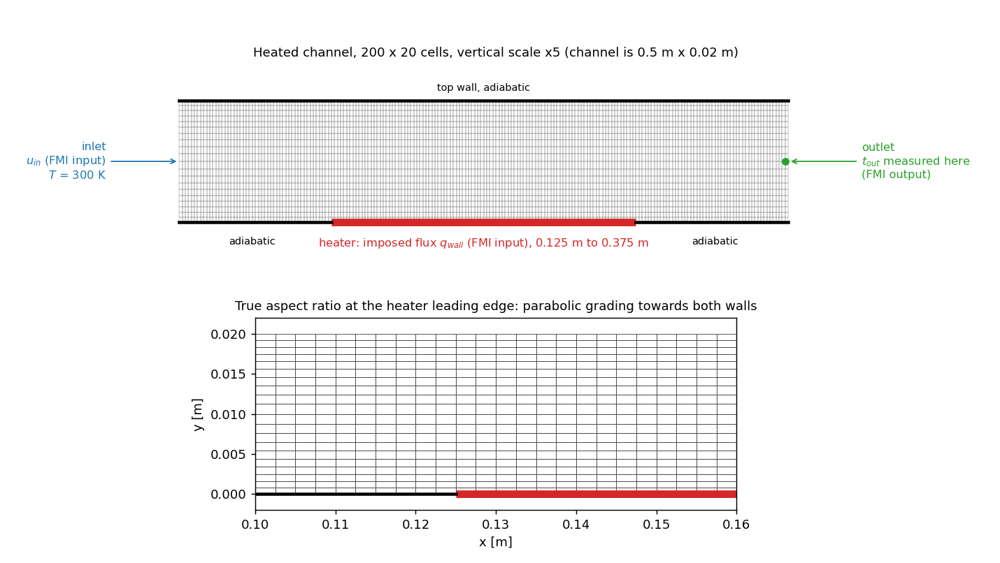
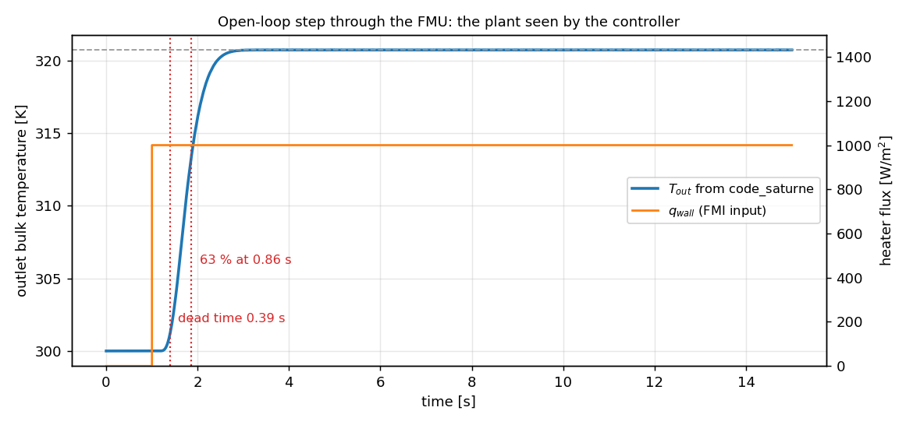
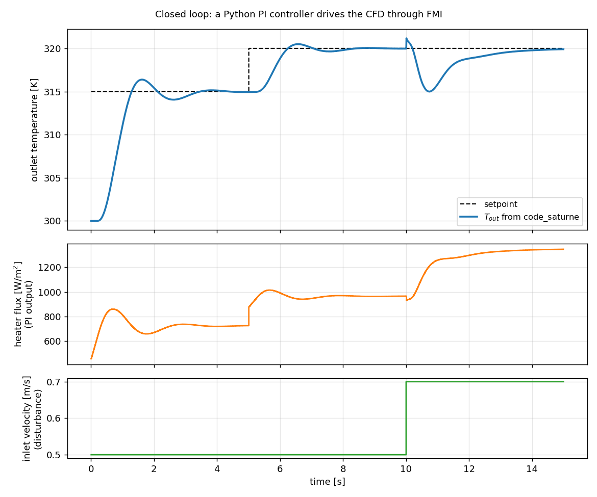
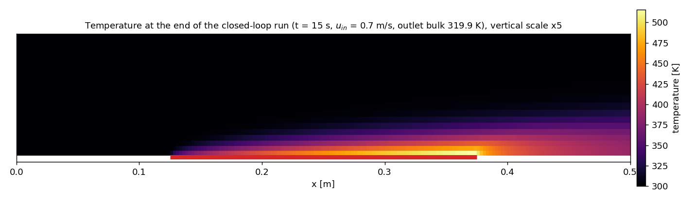

# FMI Co-simulation (A Python Controller Drives code_saturne)

A step-by-step tutorial for the **FMI 2.0 co-simulation** support of
**code_saturne**: the solver is wrapped as a Functional Mock-up Unit (FMU), a
Python master drives it one time step at a time through
[FMPy](https://github.com/CATIA-Systems/FMPy), and a PI controller written in
twenty lines of Python holds the outlet temperature of a heated channel by
modulating the heater power. The CFD is the plant inside the control loop.
Everything crosses the boundary through **notebook variables**, and one FMI
step is exactly one code_saturne time step.

Maintained by [Simvia](https://Simvia.tech/fr), part of the
[tutoriel-code_saturne](https://github.com/simvia-tech/tutorials-code_saturne) collection.

## Learning objectives

After completing this tutorial you will be able to:

1. Expose notebook variables of a case as FMI inputs and outputs.
2. Build the code_saturne FMU from the sources shipped in `extras/FMI`.
3. Drive the solver step by step from Python with FMPy.
4. Identify the plant from an open-loop step run through the FMU and tune a PI
   controller from it.
5. Close the loop, follow a setpoint change and reject a flow disturbance.

## Prerequisites

| Requirement | Detail |
|---|---|
| code_saturne | **v9.1**, a native installation (see below) |
| Toolchain | `g++`, `make`, `zip` |
| Python | Python 3 with FMPy 0.3.32 (`pip install fmpy`, in a virtual environment) |
| Background | The [Notebook Parameters](../../00_foundations/Inc_Notebook_Parameters/) tutorial, basic notions of feedback control |

The FMU launches `code_saturne run` as a subprocess and talks to the solver
over a local socket, so the master, the FMU and the solver must live on the
same machine. This tutorial therefore uses a **native** code_saturne
installation, built from the [official homepage](https://code-saturne.org/).
The Docker image used elsewhere in this collection ships neither the FMU
sources nor a `zip` or `pip`, and is not covered here.

## Case files

```text
Cpl_FMI_Heater_Control/
├── CASE/
│   ├── DATA/setup.xml                    # the heated channel, with three notebook variables
│   └── SRC/cs_user_extra_operations.cpp  # measures the outlet bulk temperature each step
├── FMU/
│   ├── src/, fmi/                        # the FMU sources, from code_saturne 9.1 extras/FMI
│   ├── fmu_generator.py, Makefile        # build the .fmu from modelDescription.xml
│   ├── modelDescription.xml              # the FMI face of this case: 3 parameters, 2 inputs, 1 output
│   └── run_cosim.py                      # the master: FMPy loop, open-loop step or PI control
├── FIGURES/
└── README.md
```

There is no mesh file: the channel is built by code_saturne's Cartesian mesher
from `setup.xml`. The `FMU/` directory embeds the FMU sources of code_saturne
9.1 (`extras/FMI`, GPL-2.0, EDF S.A.) so that the tutorial builds without the
source tarball. They are verbatim except for three small patches, listed at the
end of this document.

## Physical model

Air flows through a plane channel, laminar and incompressible, with the energy
equation solved for the temperature. A segment of the bottom wall imposes a heat
flux $q_{wall}$, every other wall is adiabatic. The quantity of interest is the
mixing (bulk) temperature at the outlet,

$$
T_{out} = \frac{\displaystyle\int \rho\,u\,T\,\mathrm{d}A}{\displaystyle\int \rho\,u\,\mathrm{d}A},
$$

which an energy balance fixes at steady state, whatever the mesh:

$$
T_{out} - T_{in} = \frac{q_{wall}\,L_{heater}}{\rho\,U\,H\,c_p}.
$$

### Flow parameters

| Quantity | Value |
|---|---|
| Channel | $L$ = 0.5 m, $H$ = 0.02 m, unit depth (2D) |
| Fluid | air, $\rho$ = 1.2 kg/m³, $\mu$ = 1.8e-5 Pa s, $c_p$ = 1005 J/(kg K), $\lambda$ = 0.026 W/(m K) |
| Inlet | $U$ = 0.5 m/s, $T_{in}$ = 300 K, so $Re_H$ = 667 and a transit time of 1 s |
| Heater | bottom wall from $x$ = 0.125 m to 0.375 m ($L_{heater}$ = 0.25 m) |
| Design point | $q_{wall}$ = 1000 W/m² gives $T_{out} - T_{in}$ = 20.73 K |
| Time step | 5 ms, the FMI communication step as well |

## The coupling (the feature)

### What the FMU does

The code_saturne FMU is a small shared library (`FMU_CS.so`, zipped into
`FMU_CS.fmu`) that acts as a **client** of a running solver. When the master
enters initialization mode, the FMU:

1. runs `code_saturne run --initialize --force --id=<run_id>` in the case,
2. opens a listening socket and writes a `control_file` in `RESU/<run_id>` that
   says `connect host:port key`,
3. starts `./run_solver` in that directory; the solver reads the control file
   and connects back,
4. declares the exchanged variables to the solver.

From then on, every `fmi2DoStep` is one solver iteration:

| FMU sends | Solver answers |
|---|---|
| `advance 1` | `0`, then the current values of the outputs (binary) |
| the values of the inputs (binary) | runs one time step, then `Iteration OK` |

At `fmi2Terminate` the FMU clamps the number of time steps to the current one
and disconnects; the solver finishes its run normally, with the usual
post-processing output.

### Notebook variables are the whole interface

The FMU exchanges nothing but notebook variables, under their notebook names.
This case declares three of them in `setup.xml`:

```xml
<notebook>
  <var name="q_wall" value="1000" editable="Yes" description="heater flux density [W/m2], FMI input"/>
  <var name="u_in"   value="0.5"  editable="Yes" description="inlet velocity [m/s], FMI input"/>
  <var name="t_out"  value="300"  editable="Yes" description="outlet bulk temperature [K], FMI output"/>
</notebook>
```

The two inputs are used where any notebook variable can be used, in MEG
formulas of the boundary conditions:

```text
inlet velocity :  u_norm = u_in;
heater flux    :  flux = -q_wall;
```

The minus sign is code_saturne's convention: the Neumann value of a scalar is
the **outgoing** flux, so heating the fluid is a negative number. Getting this
wrong cools the channel instead of heating it.

The output is a sensor that the solver has to fill in. Once per time step,
`cs_user_extra_operations.cpp` integrates the mass flux weighted temperature over
the outlet faces and stores the result in `t_out`:

```cpp
const cs_zone_t *z = cs_boundary_zone_by_name_try("outlet");
/* ... sum b_mass_flux * T over the outlet faces, cs_parall_sum ... */
cs_notebook_parameter_set_value("t_out", sum[0]/sum[1]);
```

That is why `t_out` is declared `editable="Yes"` although nothing outside the
solver ever sets it: `cs_notebook_parameter_set_value` refuses non-editable
entries. Forgetting the flag stops the run at the first time step.

### One `fmi2DoStep` is one time step

The FMU ignores the communication step size the master passes and always
advances the solver by exactly one iteration. The master must therefore step
with the time step of the case (`time_step_ref`, 5 ms here) and the case must be
a genuine transient (`time_passing` set to 0); a pseudo-steady setup with a
local time step would make FMI time and solver time drift apart. The number of
time steps in `setup.xml` is ignored while the FMU is connected: the master
decides when to stop.

### The model description

`FMU/modelDescription.xml` is the FMI side of the same three variables. Three
string parameters tell the FMU how to launch the solver, and the master sets
them at instantiation:

```xml
<ScalarVariable name="code_saturne" causality="parameter" variability="fixed" initial="exact">
    <String start="/path/to/code_saturne/bin/code_saturne"/>
</ScalarVariable>
<ScalarVariable name="casename"     .../>   <!-- the CASE directory -->
<ScalarVariable name="run_id"       .../>   <!-- results go to RESU/<run_id> -->
<ScalarVariable name="q_wall" valueReference="0" causality="input"  variability="discrete">
    <Real start="1000.0"/>
</ScalarVariable>
<ScalarVariable name="u_in"   valueReference="1" causality="input"  variability="discrete">
    <Real start="0.5"/>
</ScalarVariable>
<ScalarVariable name="t_out"  valueReference="2" causality="output" variability="continuous" initial="exact">
    <Real start="300.0"/>
</ScalarVariable>
```

## Geometry and boundary conditions

<p align="center">
  
</p>

The mesh is 200 cells along the channel and 20 across, graded parabolically
towards both walls (first cell 0.80 mm). The heater is a sub-segment of the
bottom wall, selected with `Y0 and box[0.125, -1, -1, 0.375, 1, 1]`, and the
adiabatic remainder with `Y0 and not box[...]`; the run log confirms 100 faces
on each.

| Boundary | Selection | Condition |
|---|---|---|
| inlet | `X0` | velocity norm `u_in` (formula), $T$ = 300 K |
| outlet | `X1` | free outlet |
| heater | `Y0 and box[...]` | no-slip wall, Neumann flux `-q_wall` (formula) |
| bottom_wall, top_wall | `Y0 and not box[...]`, `Y1` | no-slip, adiabatic |
| sides | `Z0 or Z1` | symmetry |

## Numerical setup

| Setting | Value |
|---|---|
| Time scheme | transient, constant $\Delta t$ = 5 ms (CFL about 1) |
| Velocity-pressure | SIMPLEC |
| Turbulence | none (laminar) |
| Thermal scalar | temperature in kelvin, constant properties |
| Standalone run length | 3000 steps, 15 s (ignored once the FMU is connected) |

## Running the simulation

### Step 1: check the case alone

Before any coupling, run the case as an ordinary transient with the notebook
defaults ($q_{wall}$ = 1000 W/m², $u_{in}$ = 0.5 m/s):

```bash
cd Cpl_FMI_Heater_Control/CASE
code_saturne run --nprocs 4
grep t_out RESU/*/run_solver.log | tail -1
```

The last line should read `t_out = 320.72 K`; the energy balance gives 320.73 K.
If the case does not close this balance on its own, nothing downstream will.

### Step 2: build the FMU

```bash
cd ../FMU
python3 fmu_generator.py     # reads modelDescription.xml, writes code_saturne_fmu_variables.h
make                          # compiles src/ into binaries/linux64/FMU_CS.so and zips FMU_CS.fmu
```

The FMU is specific to this `modelDescription.xml`: change a variable there and
rebuild. It is not specific to a machine, since the paths are FMI parameters.

### Step 3: install FMPy

System Python on recent distributions refuses `pip install` (PEP 668), so use a
virtual environment:

```bash
python3 -m venv ~/.venvs/fmi
~/.venvs/fmi/bin/pip install fmpy
```

### Step 4: the open-loop step

```bash
~/.venvs/fmi/bin/python run_cosim.py open-loop \
    --code-saturne /path/to/code_saturne/bin/code_saturne
```

The master instantiates the FMU, sets the three paths, then steps 3000 times
with the heater off for one second and at 1000 W/m² afterwards, logging
`t_out` every step. Results land in `CASE/RESU/fmi_open_loop/`, the usual
code_saturne output plus `cosim.csv`.

### Step 5: the closed loop

```bash
~/.venvs/fmi/bin/python run_cosim.py pid \
    --code-saturne /path/to/code_saturne/bin/code_saturne
```

Same loop, but the heater flux is now computed each step by a PI controller from
the error between the setpoint and `t_out`. The setpoint is 315 K, then 320 K
from $t$ = 5 s; at $t$ = 10 s the inlet velocity jumps from 0.5 to 0.7 m/s as a
disturbance. Gains are `--kp` and `--ki`, actuator limits `--q-max`.

Each run takes about 200 s: the same 3000 steps take 60 s standalone, the rest
is the round trip through the socket at every step, which is the price of
exchanging values at each iteration.

A pitfall worth knowing: set the initial inputs **before**
`enterInitializationMode`, as `run_cosim.py` does. The FMU declares its inputs
to the solver when it enters that mode, and the 9.1 solver declares a variable
again each time it hears about it, so setting an input during initialization
makes the solver expect one more value per step than the FMU sends, and the
first step never returns.

## Results and verification

### The plant, seen through the FMU

<p align="center">
  
</p>

The step response is what the controller has to deal with: a **dead time of
0.39 s** while the heated fluid travels from the heater to the outlet, then a
first-order rise with a **time constant of 0.47 s**, up to a **gain of
0.0207 K per W/m²**, which is $L_{heater}/(\rho U H c_p)$ to three digits. The
final value, 320.73 K, is the energy balance of Step 1: the FMI path adds no
error to the physics. This dead time is the thing a lumped model would have to
be told about; the CFD produces it from the geometry.

The gains of the PI controller follow from these three numbers with the SIMC
rules (Skogestad, 2003): $K_c = \tau / (K (\tau_c + L))$ with $\tau_c = L$, and
$T_i = \min(\tau,\ 4(\tau_c + L))$, which gives $K_p$ = 30 W/m² per K and
$K_i = K_p / T_i$ = 60 W/m² per K per second. Those are the defaults of
`run_cosim.py`.

### The closed loop

<p align="center">
  
</p>

| Phase | Behaviour |
|---|---|
| Start-up to 315 K | reached in 1.3 s with a 1.4 K overshoot, settled within 0.01 K by $t$ = 5 s |
| Setpoint step to 320 K | 0.5 K overshoot, settled within 0.01 K by $t$ = 10 s |
| Inlet velocity 0.5 to 0.7 m/s | $T_{out}$ drops 5 K within 0.7 s, back within 0.10 K after 5 s |

The last row is the point of the exercise. A 40 % increase of the flow rate
dilutes the heating; the controller raises the flux towards the new balance,
1350 W/m² by the energy equation at 0.7 m/s, and the outlet temperature returns
to its setpoint without anyone telling the controller that the flow changed. The
recovery is slow because the integral term does the work, as it should with a
dead-time plant tuned conservatively.

<p align="center">
  
</p>

The final field shows why the plant has a dead time: heat enters at the wall
over the heater and is carried downstream before it reaches the outlet. It also
shows how hot a laminar air channel gets: the wall over the heater sits about
200 K above the bulk, which is what laminar heat transfer at this Reynolds
number costs. The temperature clipping in `setup.xml` is set to 1000 K for that
reason; the default of a few hundred kelvin would clip the wall cells and break
the energy balance.

## Patches to the FMU sources

The `FMU/src/code_saturne.cpp` shipped here differs from code_saturne 9.1
`extras/FMI` in three places, each marked `LOCAL PATCH` in the file:

- **String parameters were read from the compiled defaults.** `fmi2SetString`
  stored the values correctly, but the launch code read the start values baked
  in from `modelDescription.xml`, so the paths set by the master were ignored.
  Seven assignments now read the live values, and the initial copy is
  null-terminated.
- **Inputs were declared twice.** `_set_real` declared an input to the solver the
  first time it was set, although initialization had already declared it. With
  a solver that appends a new entry on every declaration, the per-step binary
  exchange then had the wrong size. `_set_real` now only stores the value.
- **Termination deadlocked.** `fmi2Terminate` sent `advance 0`, to which the
  solver still answers with the binary exchange while the FMU does not perform
  it; the solver then read the `disconnect` text as input bytes and died on the
  closed socket. The `advance 0` is removed; clamping the time step count and
  disconnecting ends the run cleanly, with `END OF CALCULATION` in the log.

Without these patches the tutorial as written does not run. They are reported
upstream.

## Summary

This tutorial wrapped a code_saturne case as an FMI 2.0 co-simulation unit and
drove it from Python, one time step per FMI step, with notebook variables as
the only interface: two inputs set from the master, one output measured in a
user routine. An open-loop step run through the FMU identified the plant (a
dead time of 0.39 s from the transport between heater and outlet, a time
constant of 0.47 s, a gain matching the energy balance), a PI controller tuned
from those numbers held the outlet temperature to 0.01 K, and it rejected a 40 %
flow disturbance to 0.10 K in 5 s. The same mechanism connects code_saturne to any FMI
master: a system model in Modelica, a controller in Simulink, or twenty lines of
Python.

## References

1. Modelica Association, *Functional Mock-up Interface for Model Exchange and
   Co-Simulation, version 2.0.4*, <https://fmi-standard.org/>.
2. code_saturne source tree, `extras/FMI/README.md`, EDF S.A.
3. FMPy, <https://github.com/CATIA-Systems/FMPy>.
4. S. Skogestad, "Simple analytic rules for model reduction and PID controller
   tuning", *Journal of Process Control*, 13 (2003) 291-309.
5. code_saturne documentation: <https://code-saturne.org/doc/>.

## Authors

[Simvia](https://Simvia.tech/fr) - Questions, remarks and requests are welcome.
