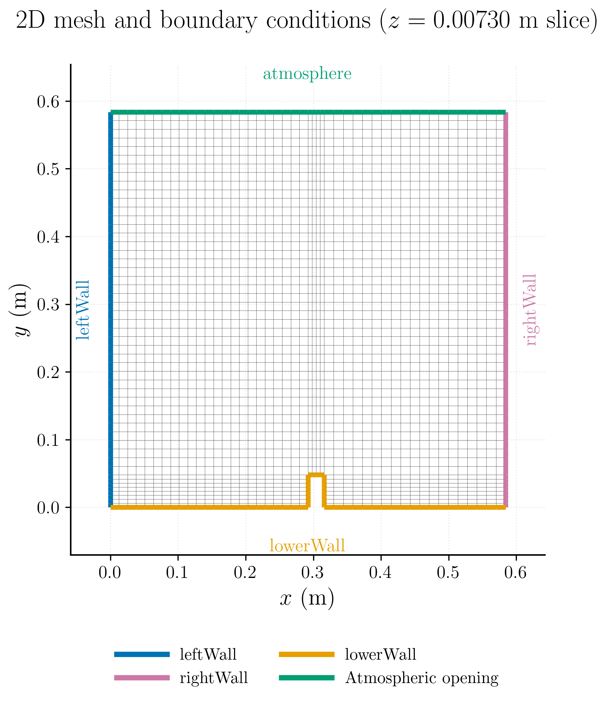
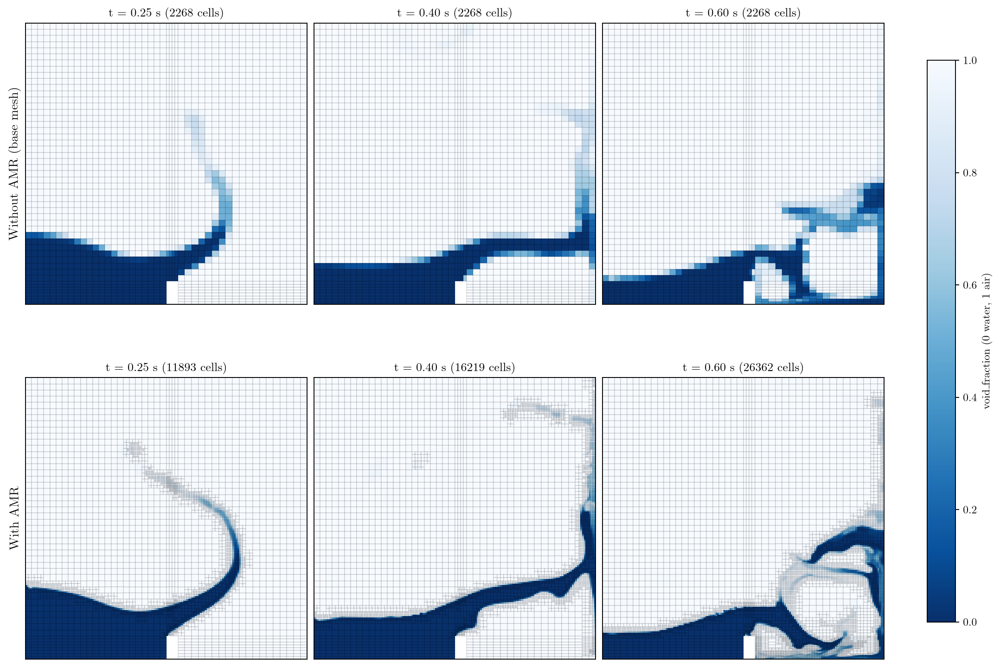

# Adaptive Mesh Refinement Following a Free Surface (VOF Dam Break)

This tutorial shows how to activate adaptive mesh refinement (AMR) on a
free-surface case. It takes the [Vof_Dam_Break](../../50_vof/Vof_Dam_Break)
case, a water column collapsing onto a bottom obstacle, and lets the mesh refine
around the water-air interface as it moves.

It is a **demonstration of how AMR is set up**, not a validation or verification
case.

Maintained by [Simvia](https://Simvia.tech/fr), part of the
[tutoriel-code_saturne](https://github.com/simvia-tech/tutorials-code_saturne) collection.

## Learning objectives

After completing this tutorial you will be able to:

1. Activate adaptive refinement with `cs_adaptive_refinement_define`.
2. Write a refinement indicator based on the VOF volume fraction.
3. Post-process a mesh that changes during the run.

## Prerequisites

| Requirement | Detail |
|---|---|
| code_saturne | **master (9.3-alpha)**, built from source |
| Tutorials | [Vof_Dam_Break](../../50_vof/Vof_Dam_Break) (same physics and mesh), [Amr_Vortex_Wake](../Amr_Vortex_Wake) (AMR on a vortex street) |

If code_saturne is not yet installed, build it from the
[official homepage](https://code-saturne.org/), pull a
ready-to-use Singularity image from the
[Open Simulation Center](https://open-simulation-center.org/downloads/code_saturne/code_saturne),
or pull the
[Simvia Docker image](https://hub.docker.com/r/Simvia/code_saturne) before continuing.

## Case files

```text
Amr_Dam_Break/
├── CASE/
│   ├── DATA/
│   │   └── setup.xml               # pre-configured GUI case
│   └── SRC/
│       └── cs_user_parameters.cpp  # AMR activation and indicator
├── MESH/
│   └── damBreak_with_groups.med    # same mesh as Vof_Dam_Break
├── FIGURES/                        # figures used in this README
└── README.md
```

## Case description

The physics, mesh and initial state are those of
[Vof_Dam_Break](../../50_vof/Vof_Dam_Break), whose README describes them in
detail: water and air at rest in a $0.584\times0.584$ m tank one cell thick,
gravity and surface tension, a fixed time step of $2.5\times10^{-4}$ s for 3000
steps (0.75 s).

<p align="center">
  
  <br>
  <em>Figure 1: The base mesh (2 268 cells), starting point of every
  adaptation.</em>
</p>

## Activating AMR

AMR has no GUI page. It is declared in `cs_user_parameters`, in
`CASE/SRC/cs_user_parameters.cpp`:

```c
cs_adaptive_refinement_define(2,        /* maximum refinement level */
                              5,        /* adapt every 5 time steps */
                              _interface_amr_indicator,
                              nullptr,  /* no input for the indicator */
                              0,        /* P0 interpolation of the fields */
                              false);   /* no load balancing */
```

The first argument is the maximum refinement level: with 2, the finest cells
are four times smaller than the base cells in each direction.

At each adaptation, the indicator marks the cells to refine. A marked cell is
split once more until it reaches the maximum level; a cell that is no longer
marked is merged back. The refined zone therefore follows the interface.

### The indicator

The indicator marks the cells crossed by the interface, where the volume
fraction $\alpha$ (`void_fraction`, 0 in water, 1 in air) takes intermediate
values, and the two cells of any face across which $\alpha$ jumps sharply.
One layer of neighbouring cells is added, so that the interface stays in the
fine zone between two adaptations.

```c
for (cs_lnum_t c = 0; c < n_cells; c++)
  if (alpha[c] > AMR_ALPHA_MIN && alpha[c] < AMR_ALPHA_MAX)
    vals[c] = 1;

for (cs_lnum_t f = 0; f < n_i_faces; f++) {
  const cs_lnum_t c0 = i_face_cells[f][0], c1 = i_face_cells[f][1];
  if (fabs(alpha[c1] - alpha[c0]) > AMR_JUMP)
    vals[c0] = vals[c1] = 1;
}
```

The settings are `#define` constants at the top of the file. `AMR_ENABLE = 0`
switches AMR off and runs the case on the base mesh.

### Post-processing

In the GUI, the results writer is set to **transient connectivity**
(*Postprocessing > Writers*). With the default (fixed mesh), the output would
show the initial mesh whatever the solver has done.

## Running the simulation

```bash
cd CASE
code_saturne run
```

The run takes about seven minutes on one core.

## Results

<p align="center">
  
  <br>
  <em>Figure 2: Volume fraction (dark: water) and mesh in the mid plane, on the
  base mesh without AMR (top) and with AMR (bottom). The fine cells follow the
  jet over the obstacle (0.25 s), the run-up on the right wall (0.40 s) and the
  overturning sheet (0.60 s).</em>
</p>

The refined zone stays on the interface and is coarsened back behind it. On the
base mesh the jet over the obstacle is a few cells thick and smeared; with AMR
it is a sharp sheet, and the overturning sheet and the air pocket under it are
resolved at 0.60 s. The adapted mesh grows from 2 268 cells to about 32 000 at
the end of the run, as the interface lengthens and breaks up.

Refinement is isotropic: each split cuts a cell into eight, including through
the thickness of this one-cell-thick mesh.

## References

1. code_saturne documentation: <https://code-saturne.org/doc/>.

## Authors

[Simvia](https://Simvia.tech/fr) - Questions, remarks and requests are welcome.
